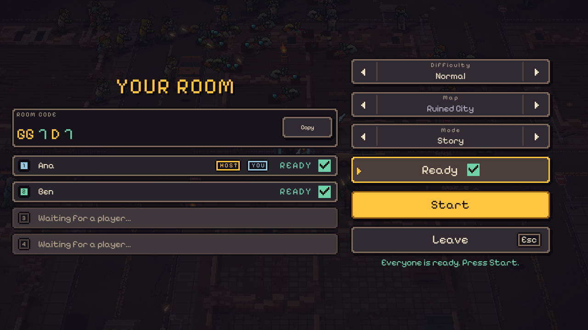
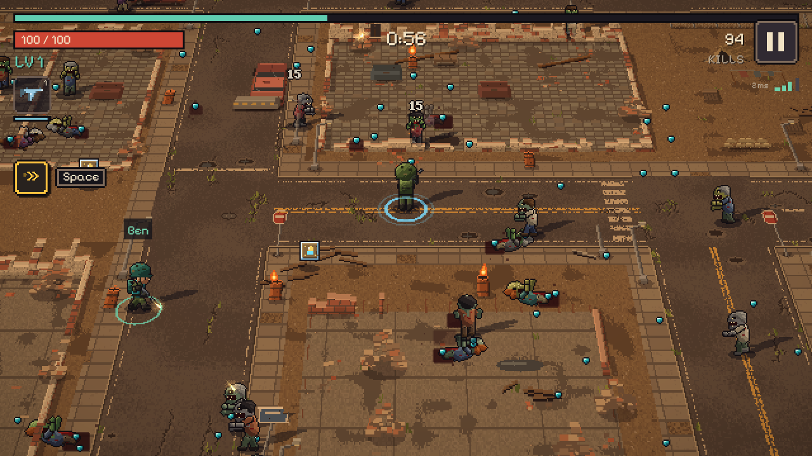

# Last Stand

A pixel-art zombie survivors game in C++20, compiled to WebAssembly so it runs in a browser with no install or account. All art, music and sound are generated in code, so the project has no image or audio assets.

**Play in your browser: [shanpla.github.io/Last-Stand](https://shanpla.github.io/Last-Stand/)**


| | |
|---|---|
|  |  |
|  |  |

**Online co-op for 2 to 4 players,** in the browser: the host's lobby with its room code (left), and a run with two soldiers (right).

| | |
|---|---|
|  |  |


## The game

Survive 10 minutes against a growing horde, then fight the final boss. You only move: weapons fire automatically.

- **10 weapons,** each with 5 levels: Rifle, Shotgun, SMG, Sniper, Flamethrower, Grenade Launcher, Homing Rockets, Landmines, Tesla Coil and Combat Blades. Hold up to 6.
- **6 passives** and **5 evolutions.** A maxed weapon plus the right passive evolves into a stronger form.
- **Limited ammo.** Guns use magazines and reloads, and crates keep you supplied. An empty Rifle still fires weak free shots, so you can always fight back.
- **8 zombie types and elites,** plus a 3-phase boss with telegraphed attacks. Its health scales with your build.
- **Two endless maps,** a ruined city and a desert highway wasteland, generated from the run's seed, with a day cycle that moves from dusk into night.
- **Solid wrecked cars.** You and the zombies slide around them, Chargers crash into them, and the boss flattens every one it steps on.
- **A dash with a cooldown,** **Easy, Normal, Hard and Hell,** and an **Endless** mode where the boss keeps returning stronger every 10 minutes. Play stays one press away.
- **A boss with a move set per level.** Harder levels add new attacks, give shorter warnings, and make it look more horrid.
- **Online co-op, 2 to 4 players, in the browser.** One player hosts a room and shares its 5-character code. Everyone gets their own level, XP and weapons. A level-up does not pause the game: while you pick a card you are shielded for a few seconds, and for 2 seconds after the pick. A downed player is revived when a teammate stands near them. More players mean more zombies and a tougher boss. The host picks the map, difficulty and mode in the lobby, a player who drops can rejoin, and co-op runs do not count for best runs. Single-player stays offline and needs no server.

### Controls

| Device | Move | Dash | Menus |
|---|---|---|---|
| Keyboard | WASD or arrow keys | Space or Shift | Arrow keys, Enter, Esc |
| Touch | The stick in the lower left corner | The DASH button in the lower right corner | Tap |
| Gamepad | Left stick | Right shoulder button | D-pad or stick, A, B, Start |
| Mouse | Not used for moving | Click the dash icon under the weapons | Click |

In the co-op menus, paste a room code with Ctrl+V. In a co-op run, F3 shows a network overlay. On a gamepad, hold the left shoulder button and press View.

## How it works

| Topic | Approach |
|---|---|
| Language and libraries | C++20, [raylib](https://www.raylib.com/), CMake, [Emscripten](https://emscripten.org/) targeting WebGL2 |
| Simulation | Fixed 60 Hz step, separate from rendering, with interpolation. Plain C++ with no graphics dependency |
| Repeatable runs | Seeded random numbers, so the same seed and inputs give the same run. Checked by a test |
| Large crowds | Object pools and a spatial hash, with no heap allocation per frame in gameplay |
| Art | Sprites and map chunks painted in code at runtime, using a palette-indexed texture atlas |
| Audio | Sound effects and layered music synthesized in code at startup |
| Solid cars | Car positions come from the seed in code with no graphics, so the simulation and the painted map always agree. No pathfinding: zombies steer to corners |
| Saves | Local storage only, versioned and safe if data is missing or corrupt. No accounts or analytics. The only server is the co-op relay, and single-player never touches it |
| Co-op networking | Host-authoritative: the host runs the one real simulation. Guests send their inputs 30 times a second and get world snapshots 20 times a second, capped at 8 KB, and predict their own soldier. Connections are WebRTC data channels using public STUN servers. If a direct connection fails, the relay server passes the game messages instead |
| Relay server | A small Node 22 and [ws](https://github.com/websockets/ws) server in [server/](server). It handles rooms, the lobby, WebRTC signaling, limits and allowed origins, and has no game logic. It runs on Render's free plan, which sleeps when idle and takes about a minute to wake |
| Offline | An installable web app that keeps working with no connection. Each cached file is checked against the build's own hash |

[docs/ARCHITECTURE.md](docs/ARCHITECTURE.md) explains the whole system in plain language, including what was chosen, what was rejected and why.

## Measured

Measured on a laptop with an Intel UHD integrated GPU, in headless Chrome. Real phones have not been measured yet. Co-op has been tested on one computer with two browser windows, not yet across the internet between two real machines.

| Measure | Result |
|---|---|
| Stress test: 2,000 zombies and 3,000 shots at 1920x1080 | Locked at the 144 Hz display, with a 99th percentile frame gap of 7.3 ms |
| 2,000 zombies at phone size, with the processor slowed 6 times as a stand-in for a weak phone | Average above 30 fps, though single frames drop below it. This does not slow the graphics chip |
| Compressed download | About 493 KB on a first visit (gzip at level 9 of the 14 files the page loads) |
| Tests | 385 unit test cases, 381 browser tests and 127 server tests, all passing |

Balance is checked by bots that play 100 games per setting on seeds not used for tuning:

| Difficulty | Novice bot | Average bot | Skilled bot |
|---|---|---|---|
| Easy | Reaches the boss in 55 to 60% of games | Wins 98 to 100% | Wins 99 to 100% |
| Normal | Survives a median of about 3:56 | Wins 26% | Wins 61 to 70% |
| Hard | Survives a median of about 3:40 | Wins 2 to 3% | Wins 26 to 30% |
| Hell | Survives a median of about 2:20 | Never wins | Wins 7 to 13% |

Bots can measure balance, but not whether the game is fun. That needs people playing it.

## Status

The whole game is playable from title to victory or death. A PC download is on the [Releases](https://github.com/ShanPla/Last-Stand/releases) page. The PC download has no co-op: co-op is browser only for now.

**Privacy in co-op:** with WebRTC, the players in a room can see each other's IP addresses, as in most peer-to-peer games. There are no accounts and no analytics.

[docs/prototypes](docs/prototypes) shows how the look developed.

## Build it

You need Visual Studio 2022 with C++ tools, CMake 3.24 or newer, Ninja, Node 22 and, for the browser build, [Emscripten](https://emscripten.org/docs/getting_started/downloads.html) 6.0.13 with `EMSDK` set. raylib is downloaded by CMake at a pinned version.

```sh
# Browser build, served at http://127.0.0.1:8080/
cmake --preset web
cmake --build --preset web
npm ci
npm run serve

# Native Windows build, for debugging
cmake --preset native
cmake --build --preset native
```

To try co-op locally, run the relay server in a second terminal. A page opened from localhost uses it automatically, on port 8787. Open the game in two browser windows, host in one and join with the room code in the other.

```sh
cd server
npm ci
npm start   # listens on http://localhost:8787
```

Add `?debug` to the page URL to show the performance overlay. On the PC build, developer builds show it, and a Release build shows it when started with `--debug`.

## Tests

```sh
# Unit tests and full bot runs, no window needed
./build/native/RelWithDebInfo/ls_tests.exe

# Browser tests, using your installed Chrome
npm run test:e2e

# Relay server tests
npm test --prefix server

# Plays many bot games and prints balance tables
./build/native/RelWithDebInfo/ls_balance.exe --seeds 100
```

## License

[MIT](LICENSE), copyright Shan Platon.

Third-party parts keep their own licenses: [raylib](https://github.com/raysan5/raylib) (zlib), [Pixelify Sans](src/components/Ui/Font/OFL.txt) (SIL Open Font License) and [doctest](third_party/doctest/LICENSE.txt) (MIT, tests only).
