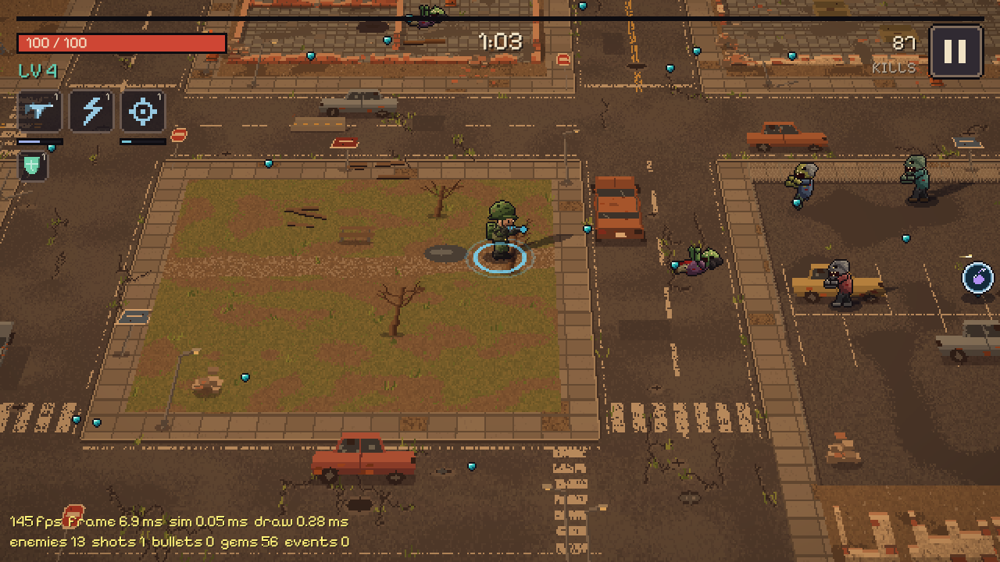

# Last Stand

A pixel-art zombie survivors game in C++20, compiled to WebAssembly so it runs in a browser with no install or account. All art, music and sound are generated in code, so the project has no image or audio assets.

**Play:** the live link is coming soon. The game is still in development.



## The game

Survive 10 minutes against a growing horde, then fight the final boss. You only move: weapons fire automatically.

- **10 weapons,** each with 5 levels: Rifle, Shotgun, SMG, Sniper, Flamethrower, Grenade Launcher, Homing Rockets, Landmines, Tesla Coil and Combat Blades. Hold up to 6.
- **6 passives** and **5 evolutions.** A maxed weapon plus the right passive evolves into a stronger form.
- **Limited ammo.** Guns use magazines and reloads, and crates keep you supplied. An empty Rifle still fires weak free shots, so you can always fight back.
- **8 zombie types and elites,** plus a 3-phase boss with telegraphed attacks. Its health scales with your build.
- **An endless ruined city,** generated from the run's seed, with a day cycle that moves from dusk into night.

### Controls

| Device | Move | Menus |
|---|---|---|
| Keyboard | WASD or arrow keys | Arrow keys, Enter, Esc |
| Touch | Drag anywhere for a floating joystick | Tap |
| Gamepad | Left stick | D-pad or stick, A, B, Start |
| Mouse | Not used for moving | Click |

## How it works

| Topic | Approach |
|---|---|
| Language and libraries | C++20, [raylib](https://www.raylib.com/), CMake, [Emscripten](https://emscripten.org/) targeting WebGL2 |
| Simulation | Fixed 60 Hz step, separate from rendering, with interpolation. Plain C++ with no graphics dependency |
| Repeatable runs | Seeded random numbers, so the same seed and inputs give the same run. Checked by a test |
| Large crowds | Object pools and a spatial hash, with no heap allocation per frame in gameplay |
| Art | Sprites and city chunks painted in code at runtime, using a palette-indexed texture atlas |
| Audio | Sound effects and layered music synthesized in code at startup |
| Saves | Local browser storage only, versioned and safe if data is missing or corrupt. No accounts, backend or analytics |

[docs/ARCHITECTURE.md](docs/ARCHITECTURE.md) explains the whole system in plain language, including what was chosen, what was rejected and why.

## Measured so far

| Measure | Result |
|---|---|
| Stress test: about 2,000 zombies and 2,900 shots at 1920x1080 | About 434 fps on an Intel UHD integrated GPU, in headless Chrome, before particles and glow |
| Compressed download | About 277 KB |
| Tests | 116 unit test cases and 67 browser tests |

These numbers will change as work continues. Performance on real phones has not been measured yet.

## Status

Done: simulation, weapons, zombies, boss, screens, all input methods, saves, audio, pixel-art world and a first balance pass.

In progress: particles, damage numbers, screen shake and glow, then an installable web app, a PC download, a final balance pass from playtesting, and the public release.

[docs/prototypes](docs/prototypes) shows how the look developed.

## Build it

You need Visual Studio 2022 with C++ tools, CMake 3.24 or newer, Ninja, Node 22 and, for the browser build, [Emscripten](https://emscripten.org/docs/getting_started/downloads.html) 6.0.13 with `EMSDK` set. raylib is downloaded by CMake at a pinned version.

```sh
# Browser build, served at http://127.0.0.1:8080/
cmake --preset web
cmake --build --preset web
npm ci
npm run serve

# Native Windows build, for debugging
cmake --preset native
cmake --build --preset native
```

Add `?debug` to the page URL to show the performance overlay.

## Tests

```sh
# Unit tests and full bot runs, no window needed
./build/native/RelWithDebInfo/ls_tests.exe

# Browser tests, using your installed Chrome
npm run test:e2e

# Plays many bot games and prints balance tables
./build/native/RelWithDebInfo/ls_balance.exe --seeds 100
```

## License

[MIT](LICENSE), copyright Shan Platon.

Third-party parts keep their own licenses: [raylib](https://github.com/raysan5/raylib) (zlib), [Pixelify Sans](src/components/Ui/Font/OFL.txt) (SIL Open Font License) and [doctest](third_party/doctest/LICENSE.txt) (MIT, tests only).
