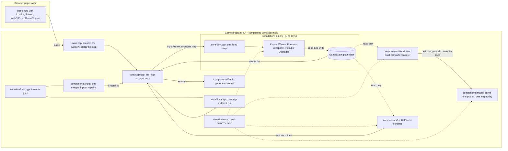
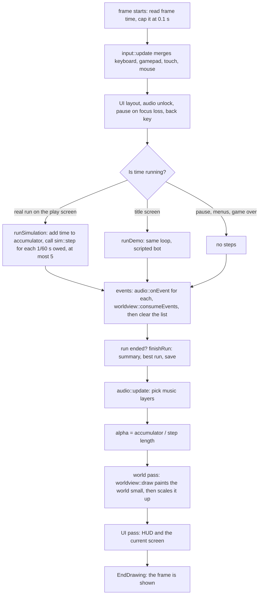
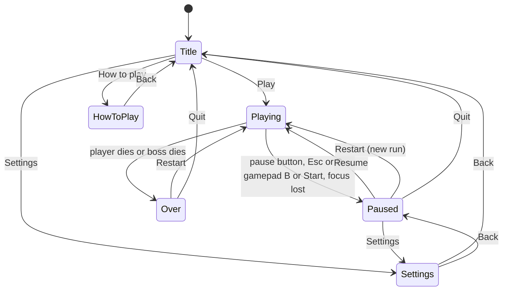

# Last Stand: how it is built

Last Stand is a zombie survivors game. You move, your weapons fire by themselves, zombies come in waves, and after ten minutes a boss arrives. It is written in C++20 with the [raylib](https://www.raylib.com/) library and compiled to WebAssembly, so it runs in a browser tab with nothing to install.

This document explains how the code works. It is written for someone who knows programming but is new to game engines and to systems-level C++. Each technical term is explained where it first appears.

**What this document covers.** It describes the code that exists in this repository now. Work that has not been written yet is marked **Planned**, and all of it is listed once, in [section 11](#11-planned-work-not-in-the-code-yet).

**How to read it.** Sections 1 to 3 give the big picture, including how the pixel-art world is drawn. Section 4 covers the memory tricks that keep the game fast, including the sprite atlas and the ground chunks. Section 5 covers game content (weapons, zombies, waves, the boss) and how to add more. Sections 6 and 7 cover the user interface, input, saves, the browser build and audio. Section 8 covers testing and measured performance. Section 9 lists the major decisions, and section 10 maps every topic to its files.

Contents:

1. [System overview](#1-system-overview)
2. [One frame, from start to finish](#2-one-frame-from-start-to-finish)
3. [Data flow and game state](#3-data-flow-and-game-state)
4. [Object pools, the spatial hash and memory layout](#4-object-pools-the-spatial-hash-and-memory-layout)
5. [Weapons, upgrades, enemies, waves and the boss](#5-weapons-upgrades-evolutions-enemies-waves-and-the-boss)
6. [UI screens, input, saves and the browser build](#6-ui-screens-input-saves-and-the-browser-build)
7. [Audio](#7-audio)
8. [Testing and performance](#8-testing-and-performance)
9. [Major decisions](#9-major-decisions)
10. [File map](#10-file-map)
11. [Planned work, not in the code yet](#11-planned-work-not-in-the-code-yet)

---

## 1. System overview

### What a game program does

Every game, from a tiny one to a huge one, runs the same loop over and over:

1. Read input.
2. Update the world (move things, check hits, apply damage).
3. Draw the world.
4. Play sound.

One pass through that loop is called a **frame**. A browser calls our `frame()` function once per display refresh, which is often 60 times a second. (The Windows build asks for 60.) The code that does the work lives in [`src/core/App.cpp`](../src/core/App.cpp).

### What WebAssembly is

**WebAssembly** (WASM) is a compact binary format that browsers can run at close to native speed. We write C++, and a compiler called **Emscripten** turns it into a `.wasm` file plus a small amount of JavaScript glue. The browser downloads the `.wasm` file and runs it next to the normal page. raylib is a C library that handles the window, input, drawing and audio. On the web it draws through **WebGL 2**, the browser's way of talking to the graphics card.

The same code also builds as a normal Windows program. That build is used for debugging and for the tests.

### How the world is drawn: the short version

The world is pixel art that the program paints itself. There are no image files. A few graphics terms come up from here on. Each is explained once, here.

- **Art pixel.** One square of the game's pixel art. On screen, one art pixel is a block of 2, 3 or more real screen pixels, so the picture looks chunky on purpose.
- **Render target.** A picture the program draws into instead of drawing straight to the screen. The game draws the whole world into a small render target (about 360 art pixels tall on a typical landscape window), then stretches that picture over the screen in one step. Because the stretch is one step, every art pixel ends up the same size.
- **Texture.** A picture stored in the graphics card's memory, ready to be drawn.
- **Texture atlas.** One texture that holds many small pictures side by side, like a sprite sheet on a web page. To draw a sprite, the program says "draw this rectangle of the atlas here". The game paints all its sprites into one atlas when it starts.
- **Palette.** A numbered list of colors. A *palette image* stores a position in that list for each pixel, not a color. Change the list and the same image shows different colors. This is how one zombie sprite can wear many different outfits.
- **Shader.** A small program that runs on the graphics card for every pixel it draws. The world uses three: one that looks up palette colors for sprites, one that colors and bends the ground, and one that scales the finished picture up.
- **Perspective projection.** The rule that turns a position in the flat game world into a position in the picture. Here it squashes the world vertically so you look down at it at an angle (the tilt), and it makes things higher up the screen a little smaller (the perspective), like a camera behind the player looking down at the ground.

[Section 2](#inside-the-world-pass) follows one world draw step by step. [Section 4](#texture-memory-the-sprite-atlas-and-the-ground-chunks) covers the memory it uses.

### The modules



Solid arrows carry data or calls. Dotted arrows are read-only. The world renderer draws into a low-resolution picture and scales it up. The UI is drawn afterward at full resolution, on top.

### What each module owns

| Module | Folder | Owns | Talks to |
|---|---|---|---|
| Game loop and screens | [`src/core/App.cpp`](../src/core/App.cpp) | The main loop, the accumulator, which screen is showing, starting and ending runs | Everything below |
| Simulation step | [`src/core/Sim.cpp`](../src/core/Sim.cpp) | The order in which game systems run each step | Player, Waves, Enemies, Weapons, Pickups, Upgrades |
| Game state | [`src/core/GameState.h`](../src/core/GameState.h) | Every number that describes a run: the player, all zombies, all shots, the clock, the random generator | Read by everyone, written by the simulation |
| Containers and helpers | [`Pool.h`](../src/core/Pool.h), [`SpatialHash.h`](../src/core/SpatialHash.h), [`Rng.h`](../src/core/Rng.h), [`Math.h`](../src/core/Math.h) | Fixed-size storage, fast neighbour search, seeded random numbers, 2D vectors | Simulation |
| Player | [`src/components/Player`](../src/components/Player) | Movement, damage taken, healing | State |
| Enemies | [`src/components/Enemies`](../src/components/Enemies) | One folder per zombie type, the boss, the wave table logic | State, Pickups |
| Weapons | [`src/components/Weapons`](../src/components/Weapons) | One folder per weapon, ammo and reloading, projectiles and zones | State, Enemies |
| Pickups | [`src/components/Pickups`](../src/components/Pickups) | XP gems, health, magnets, bombs, ammo crates | State, Upgrades |
| Upgrades | [`src/components/Upgrades`](../src/components/Upgrades) | XP and levels, the level-up cards, passives, evolutions | State, Weapons |
| Input | [`src/components/Input`](../src/components/Input) | Turning keyboard, gamepad, touch and mouse into one snapshot | Platform |
| World renderer | [`src/components/WorldView`](../src/components/WorldView) | Drawing the world from the state: the low-resolution render target, the sprite atlas and palette, the shaders, the camera, the day cycle, the ground chunk cache | State (read only), Maps |
| Maps | [`src/components/Maps`](../src/components/Maps) | Painting square chunks of ground, and the lamps and fires on them, from a seed. One map today, the ruined city | Data (colors). Called by the world renderer only |
| UI | [`src/components/Ui`](../src/components/Ui) | HUD, title, level-up cards, pause, settings, game over, font, icons | State (read only), Input |
| Audio | [`src/components/Audio`](../src/components/Audio) | Sound effects and music made in code, and the event-to-sound router | Events |
| Saves | [`src/core/Save.cpp`](../src/core/Save.cpp) | Turning settings and best-run numbers into text and back | Platform |
| Platform | [`src/core/Platform.cpp`](../src/core/Platform.cpp) | The few things that differ between browser and Windows: canvas size, storage, touch events, safe areas | raylib, the browser |
| Data | [`Balance.h`](../src/data/Balance.h), [`Theme.h`](../src/data/Theme.h) | Every tuning number, every color, and the time-of-day table | Everything |
| Page shell | [`web/`](../web) | The HTML page, loading bar, WebGL error message, canvas styling | The WASM file |

### Rules that keep the modules apart

- **The simulation never includes raylib.** It has its own 2D vector type in [`Math.h`](../src/core/Math.h). The build enforces this: the simulation is compiled as a separate library, `ls_sim`, that is not linked to raylib, so a stray `#include "raylib.h"` there fails to compile. This is what lets the tests run the whole game with no window.
- **The simulation never reads the clock.** Time only exists as a count of steps.
- **The renderer and the audio only read.** They never change the game state.
- **Events flow one way.** The simulation writes a list of things that happened. Others read it.
- **Maps stay out of the simulation.** A map only paints a picture of the ground. Nothing in the simulation asks what is on the ground, zombies and the soldier walk straight across every prop, and there are no solid obstacles. The Maps folder is built into the game program, not into `ls_sim`, and its header includes raylib, so a simulation file that tried to use it would fail to compile.

---

## 2. One frame, from start to finish

This section follows `frame()` in [`App.cpp`](../src/core/App.cpp) and `sim::step()` in [`Sim.cpp`](../src/core/Sim.cpp) in the order the code runs them.



### Step by step

1. **Resize.** `platform::syncCanvasSize` matches the drawing buffer to the canvas size on the page and the device pixel ratio (capped at 2).
2. **Read the clock.** `GetFrameTime()` gives the real seconds since the last frame. The code keeps `rawDt` for statistics and uses `dtReal = min(rawDt, 0.1)`. The cap stops a long stall (for example a hidden tab) from running a huge pile of steps afterward.
3. **Read input.** `input::update` merges every device into one `Snapshot` (see [section 6](#input-handling)). Before that, the joystick is switched on only while a real run is in the playing phase, and the pause button's rectangle is given to the input code so a touch that starts on it presses it instead of starting the joystick.
4. **Housekeeping.** The first press of any kind unlocks audio, because browsers refuse to play sound before the user does something. If the tab or window lost focus since the last frame, the game pauses. The back key (Esc, P, gamepad B or Start) pauses while playing and steps back out of menus.
5. **Advance time**, but only where time should move: in a real run on the play screen (`runSimulation`) or in the title demo (`runDemo`). Pause, settings, how-to-play and game over run no steps. The details are in [the next subsection](#fixed-timestep-the-accumulator).
6. **Handle events.** Each event the steps produced goes to `audio::onEvent` (not during the title demo, which makes no sound). `worldview::consumeEvents` reads the same list for animation timing (the soldier's muzzle flash and recoil), for where to lay down corpses, and for smoke. Then the list is cleared. See [the events subsection](#the-event-list).
7. **Check for the end of a run.** If the phase became `Dead` or `Won`, `finishRun` builds the summary, updates the best run, saves, and moves to the game over screen.
8. **Update music.** `audio::update` receives how far through the ten minutes the run is, and whether the boss is out.
9. **Compute `alpha`** (explained below), then **draw**: the world pass, then the UI pass, then the optional debug overlay, then `EndDrawing()`. The world pass draws into a small picture and scales it up ([inside the world pass](#inside-the-world-pass)). The UI pass draws on top at full screen resolution.

### Fixed timestep: the accumulator

A game could update the world by "however many milliseconds passed since the last frame". That is a **variable timestep**. It has a problem: physics gives slightly different results on a fast computer and a slow one, and you can never replay a run exactly.

Last Stand uses a **fixed timestep** instead. The simulation always advances in steps of exactly 1/60 of a second (`kDt` in [`GameState.h`](../src/core/GameState.h)). The screen may refresh at 30, 60, 144 or 240 Hz. A small counter, the **accumulator**, joins the two:

```cpp
g_accumulator += dtReal;
...
int steps = 0;
while (g_accumulator >= kDt && steps < kMaxStepsPerFrame) {
    // A menu choice applies once, even when this frame runs several steps.
    frameInput.chooseCard = static_cast<int8_t>(g_pendingChoice.card);
    frameInput.reroll = g_pendingChoice.reroll;
    g_pendingChoice = ui::LevelUpChoice{};
    sim::step(*g_state, frameInput);
    g_accumulator -= kDt;
    steps++;
}
if (steps == kMaxStepsPerFrame) g_accumulator = 0.0f;
```

Think of it as a bank account. Each frame deposits the real time that passed. Each step withdraws 1/60 s. What is left stays for the next frame.

| Display | Real time per frame | What happens |
|---|---|---|
| 60 Hz | about 16.7 ms | Usually one step per frame |
| 144 Hz | about 6.9 ms | Many frames run zero steps, some run one |
| 30 Hz | about 33 ms | Two steps per frame |
| A stall of 100 ms | capped at 100 ms | Five steps, then the leftover time is thrown away (`kMaxStepsPerFrame`) |

The last row matters. If the computer cannot keep up, running more steps makes the next frame even slower, which runs more steps, and so on. Capping the steps and dropping the leftover means the game slows down instead of freezing.

Because many frames run no step at all, anything that must reach the simulation cannot depend on "this frame". A level-up card choice is stored in `g_pendingChoice` and handed over at the next step that actually runs. An earlier version lost choices made on frames that ran no step (see [bugs worth knowing about](#bugs-worth-knowing-about)).

### Interpolation and `alpha`

The state only changes every 1/60 s, but the screen may refresh more often. If the renderer drew the latest state each time, motion would look jerky on a 144 Hz screen, because several frames would show the same picture.

**Interpolation** fixes this. Moving things store where they were one step ago (`prevPos`) as well as where they are now (`pos`). After the steps, the loop computes:

```cpp
const float alpha = g_accumulator / kDt;
```

`alpha` is a number from 0 to 1: how far we are between the previous step and the next one. The renderer draws each object at `lerp(prevPos, pos, alpha)`, which is a point part of the way between the two positions. The cost is that what you see is up to one step (16.7 ms) behind the simulation. The gain is smooth motion at any refresh rate. See `collectVisibleZombies` and `aimCamera` in [`WorldView.cpp`](../src/components/WorldView/WorldView.cpp).

### Inside the world pass

`worldview::draw(state, alpha)` in [`WorldView.cpp`](../src/components/WorldView/WorldView.cpp) is the whole world pass. It reads the state and never writes it. In order:

1. **Fit the render target to the window.** The target is a small picture, as many art pixels as the window needs. `chooseScale` decides how many screen pixels one art pixel takes. It aims for about 360 art pixel rows on landscape windows (about 420 columns on portrait ones), and it prefers a whole number (2, 3, 4...) when one is within 17% of the ideal. It also zooms in just far enough that the edge of the view never shows ground beyond the spawn circle (`kSpawnRadius`, 960 world units, minus a margin of 34). So a zombie is never seen appearing out of nothing. This is worked out for each window shape, and a browser test checks nine different shapes.
2. **Aim the camera, snapped to whole art pixels.** The camera sits on the soldier's interpolated position, rounded to the nearest art pixel (`aimCamera`). The soldier is therefore always drawn in the same spot of the picture, and the ground scrolls past in whole-pixel steps. Sprites and ground share one grid, so nothing shimmers against anything else.
3. **Paint ground chunks that are about to be needed** (`updateGround`). See [section 4](#texture-memory-the-sprite-atlas-and-the-ground-chunks).
4. **Open the render target and draw the ground** as a few textured quads, through the ground shader, which also applies the time-of-day grading. At dusk and night, pools of light from lamps and fires are then multiplied onto the ground.
5. **Draw flat marks on the ground:** boss warning shapes, mine trigger rings and the soldier's ring.
6. **Draw sprites** through the palette shader, in this order: lamp bulbs and fire, corpses, mines, gems and pickups, all shadows, then every figure sorted by depth, so nearer figures cover farther ones. The soldier is drawn a second time, faintly, on top of the crowd so he is never lost.
7. **Draw the overlays that must stay readable above a crowd:** the Charger's warning line, health bars on elites and the boss, blade trails, and the soldier's ring.
8. **Draw shots and blasts:** a soft warm glow under explosions (blended by adding colors), then explosion rings, bullets, beams and lightning.
9. **Draw smoke, flames, grenades, rockets, blades and the muzzle flash,** and last of all enemy bullets, so nothing can hide a bullet that can hurt.
10. **Close the render target and scale it up** over the window with the present shader. This is the only scaling step in the world.

The sorting in step 6 is a **counting sort** by screen height, the same linear-time idea as in [section 4](#the-counting-sort), using 512 buckets and fixed arrays. Figures in the same bucket are at almost the same height on screen, so their order cannot be noticed.

The renderer owns a few small pools of its own, because they only change how things look: up to 240 corpses, up to 180 smoke puffs, and the soldier's walk cycle and muzzle flash timers. The simulation knows nothing about them.

#### The three shaders

- **Palette shader (sprites).** Each atlas pixel is a palette column. The vertex color of each sprite says which palette row to use and how strongly the time of day tints it. The shader looks up the color in the palette texture. Hit flash, elite gold, boss phases and fire or smoke recoloring are all just different palette rows.
- **Ground shader.** The ground chunk textures are drawn with a real perspective matrix, so the graphics card does the perspective divide for every pixel and the texture stays correct across a whole chunk. The shader also applies the strong part of the time-of-day grading: tint, saturation and a small lift.
- **Present shader.** Scales the finished picture up. Inside one art pixel it reads a single flat color, and it only blends over the last screen pixel at an edge. At a whole-number scale that is exact. At any other scale every art pixel still looks the same size. It also darkens the corners (a vignette) in whole art-pixel blocks.

One GLSL source works for both builds. Only the first line differs (`#version 300 es` for the browser, `#version 330` for Windows).

#### The projection

[`Projection.h`](../src/components/WorldView/Projection.h) holds the one function, `project`, that turns a world position into a picture position. Everything in the world goes through it. It does two things:

- **Tilt.** A square on the ground is drawn shorter than it is wide: its height is multiplied by `kTiltSquash` (224/384, about 0.58). Sprites stand upright, which gives the 3/4 look.
- **Mild perspective.** The depth is `1 - kPerspective × dy`, where `dy` is how far the point is from the camera focus along the world's y axis and `kPerspective` is 0.00045. Points farther up the screen are divided by a bigger depth, so they shrink. Road lines converge a little. At the player's depth the scale is 1, and sprites are drawn 1:1 there: 0.6 art pixels per world unit (`kArtPerWorld`).

The inverse, `unproject`, finds the ground point under a picture pixel. The renderer uses it to decide which ground chunks the camera can see.

#### The day cycle

The time of day is worked out from `state.timeSeconds()`, which is `run.tick` times the step length. [`DayCycle.cpp`](../src/components/WorldView/DayCycle.cpp) blends between the rows of `kDayKeys` in [`Theme.h`](../src/data/Theme.h): golden afternoon (0 s), low sun (120 s), dusk (210 s), late dusk (300 s), night (370 s), deep night (500 s) and a blood-red sky (590 to 600 s, as the boss arrives). Each row sets the ground tint, how colorful the ground is, a small lift, a gentle tint for sprites, how bright the lamps are, how long sun shadows are, and how dark the corners are.

The ground is graded strongly. Sprites are graded only a little, so zombies and bullets stay readable at the darkest moment. Nothing about the day cycle is stored in the simulation, and it cannot change the outcome of a run. The title-screen demo calls `setFixedDayTime` to hold the clock at dusk (240 s).

[`Ground.cpp`](../src/components/WorldView/Ground.cpp) draws the lamp and fire light. Street lamps switch on as the lamp level rises, and a lamp now and then buzzes dimmer. Fires burn all the time and flicker. The setting **Reduced motion** (`setReducedMotion`) freezes the flicker, the buzzing and the fire animation. The day cycle itself keeps moving.

### What one simulation step does

`sim::step` runs the game systems in a fixed order:

```cpp
run.tick++;
applyStressTargets(state);          // debug only
player::update(state, input.moveX, input.moveY);
waves::update(state);               // spawn from the wave table, elites, boss
enemies::update(state);             // grid rebuild, move zombies, contact damage, grid rebuild
weapons::update(state);             // fire, move shots and zones, apply hits
enemies::updateBullets(state);      // enemy bullets against the player
pickups::update(state);             // gems and pickups
enemies::removeDead(state);         // remove zombies at 0 HP, drops, kills
upgrades::update(state);            // open the level-up screen if a level is owed
// then: if the player's HP is 0, the phase becomes Dead
```

Before this, `step` returns at once if the run is over. If the phase is `LevelUp`, it only handles the card choice and returns, so the world is frozen while the cards are on screen.

### Where collisions happen

There is no single "collision pass". Each system checks hits when it moves its own objects:

- **Zombie touches player:** inside `enemies::update`, a distance check per zombie.
- **Player shot touches zombie:** inside `weapons::update`, using the spatial hash to find nearby zombies ([section 4](#the-spatial-hash)).
- **Enemy bullet touches player:** inside `enemies::updateBullets`.
- **Player touches a gem or pickup:** inside `pickups::update`.
- **Boss attack zone touches player:** when the zone's warning time ends, inside `weapons::update`.

Every check is the same simple test: is the distance between two centers smaller than the sum of the two radii? The code compares squared distances, which avoids a square root.

### The event list

While the step runs, systems record things that happened with `pushEvent`:

```cpp
pushEvent(state, EventType::PlayerHit, player.pos, taken);
```

An event holds a type, a position, a number and a small detail field (which weapon, which zombie type). The events for a frame accumulate in `state.events`, a pool with room for 512. `frame()` hands them to the audio and renderer, then clears the list. If the list is full, further events are dropped. That is safe because events only drive sound and animation, and never change the simulation. Every blast sends an `Explosion` event, even one that hits nothing (`explode` in [`Weapons.cpp`](../src/components/Weapons/Weapons.cpp)), so a mine going off in an empty street still makes a sound.

---

## 3. Data flow and game state

### GameState is plain data

All simulation state lives in one struct, `GameState`, in [`GameState.h`](../src/core/GameState.h):

```cpp
struct GameState {
    Rng rng;
    RunState run;
    Player player;
    Pool<Enemy, kMaxEnemies> enemies;
    Pool<Projectile, kMaxProjectiles> projectiles;
    Pool<EnemyBullet, kMaxEnemyBullets> enemyBullets;
    Pool<Zone, kMaxZones> zones;
    Pool<Gem, kMaxGems> gems;
    Pool<Pickup, kMaxPickups> pickups;
    Pool<SimEvent, kMaxEvents> events;  // Cleared by whoever reads them.
    SpatialHash<kMaxEnemies> enemyGrid;
    ...
};
```

"Plain data" means numbers, flags and fixed-size arrays. There are no pointers between objects, no virtual functions and no objects that own other objects. Enemies refer to nothing, and nothing refers to enemies except by index. That has three practical benefits:

- **Reset is trivial.** `sim::newRun` clears the pools and writes defaults.
- **Hashing is easy.** `sim::stateHash` walks the important fields (positions, HP, counts, the random generator's state) and produces a fingerprint of the run, which the determinism test compares.
- **Reading is safe.** The renderer and UI take a `const GameState&`, so the compiler stops them from changing it.

### Who can change what

| Code | Reads state | Writes state | How |
|---|---|---|---|
| Simulation modules (`Player`, `Waves`, `Enemies`, `Weapons`, `Pickups`, `Upgrades`) | yes | **yes** | Only through `sim::step`, once per step |
| `core/App.cpp` | yes | a little | Starts runs (`sim::newRun`), clears the event list, and feeds `InputFrame` to `sim::step`. It also writes state directly in two cases: the title-screen demo (loops the clock, tops up ammo) and the debug commands, which only work with `?debug` |
| `WorldView` (renderer) | yes, `const` | no | It keeps its own private data outside the game state: the sprite atlas, the ground chunks, the soldier's walk cycle and muzzle flash timers, and small pools of corpses and smoke puffs. The time of day is a pure function of `run.tick` |
| `Maps` | no (it gets the seed as an argument) | no | `renderChunk` is a pure function of the seed and the chunk position. It uses no global state |
| `Ui` (HUD, screens) | yes, `const` | no | It returns choices (a card number, "reroll", "resume"), and `App` turns those into input or screen changes |
| `Audio` | events only | no | It never sees the game state, only `SimEvent` values |
| `Save` | no | no | It has its own `SaveData`, separate from the run |

The one path from the player into the simulation is a small struct, `InputFrame`, in [`Sim.h`](../src/core/Sim.h):

```cpp
struct InputFrame {
    float moveX = 0.0f;
    float moveY = 0.0f;
    int8_t chooseCard = -1;  // Card index picked on the level-up screen, or -1.
    bool reroll = false;
};
```

A seed plus a list of `InputFrame`s is everything needed to replay a run.

### Events flow one way

```
simulation  --pushEvent-->  state.events  --read by-->  audio, renderer  --then cleared by App-->
```

The simulation never calls audio or graphics. It records "a zombie was hit here for 12 damage". The audio code decides that this means a thump, and the renderer decides what the soldier's gun should do. If you deleted audio and graphics entirely, the simulation would run unchanged. Frontend developers will recognize this as one-way data flow: state goes down, events go up, and the view never edits the state.

### Seeded random numbers and determinism

The game uses **PCG32**, a small random number generator ([`Rng.h`](../src/core/Rng.h)). A random generator is not really random. It is a formula that turns a **seed** (a starting number) into a long sequence that looks random. The same seed always gives the same sequence.

**Determinism** means that the same inputs give the same outputs, every time. For this game: the same seed plus the same `InputFrame`s give the same run. Three rules protect it:

1. The simulation draws random numbers only from `state.rng`.
2. The simulation never reads the clock, graphics or audio.
3. Anything random for looks alone uses something else: the renderer derives variation from a zombie's id or position (`scramble` and `hashPosition` in [`Draw.h`](../src/components/WorldView/Draw.h)), the audio has its own generator (`synth::Noise`), and the bots used in testing have their own.

The ground follows the same idea. The city is painted from `state.run.seed` with hash functions of the tile position ([`TileRandom` in `Paint.h`](../src/components/Maps/City/Paint/Paint.h)), never from `state.rng`. A hash function turns a few numbers (the seed and the tile's position) into one scrambled number, and the same inputs always give the same result. So the same seed always shows the same city, and any chunk can be painted again later, in any order, and come out identical. A browser test checks this by walking away, coming back and comparing screenshots.

One honest limit: the determinism test compares two runs inside the same program build. Floating-point maths such as `sin` and `cos` may differ in the last digit between compilers, so a run recorded on Windows is not guaranteed to match one in the browser. That has not been tested. The same goes for the city: the screenshot test compares pictures inside one browser build, and the city has not been compared between Windows and the browser.

---

## 4. Object pools, the spatial hash and memory layout

A game with thousands of moving objects can spend most of its time in memory management if it is careless. Three ideas keep Last Stand fast: **object pools**, a **spatial hash**, and a **data-oriented** layout.

**Data-oriented design** means organizing data for how the computer reads it, rather than for how it looks in a diagram. Computers are fast at reading memory in order and slow at jumping around. So instead of thousands of separate objects scattered in memory, the game stores zombies as one packed array of small structs, and loops go through the array front to back.

### Object pools

An **object pool** is a fixed-size array that is reserved once and reused. Spawning a zombie does not ask the operating system for memory. It takes the next free slot. Killing one gives the slot back. [`Pool.h`](../src/core/Pool.h) is the whole implementation:

```cpp
template <typename T, int Capacity>
struct Pool {
    T items[Capacity];
    int count = 0;

    T* add() {
        if (count >= Capacity) return nullptr;
        items[count] = T{};
        return &items[count++];
    }

    void removeAt(int index) { items[index] = items[--count]; }
    void clear() { count = 0; }
    ...
};
```

(`template <typename T, int Capacity>` means one definition works for any type and size, like a generic in TypeScript, but resolved at compile time.)

The first `count` slots always hold living objects, packed together. Slots after `count` are free.

#### Swap-remove, and why loops go backward

`removeAt` does not shift everything down. It copies the **last** living item into the gap and shrinks `count` by one. This is called **swap-remove**. It costs one copy no matter how big the pool is. The price is that **order changes**, and the item now at position `i` is a different one.

That has a consequence for loops. Look at the enemy bullet loop in [`Enemies.cpp`](../src/components/Enemies/Enemies.cpp):

```cpp
for (int i = state.enemyBullets.count - 1; i >= 0; --i) {
    EnemyBullet& bullet = state.enemyBullets[i];
    ...
    if (distanceSq(bullet.pos, playerPos) < touch * touch) {
        player::damage(state, bullet.damage);
        state.enemyBullets.removeAt(i);
    } else if (bullet.life <= 0.0f) {
        state.enemyBullets.removeAt(i);
    }
}
```

Suppose the loop went forward and removed item 3. The last item (say item 9) would be copied into slot 3, and the loop would move on to slot 4. The item now in slot 3 would never be checked this step. Going **backward** fixes it: the item swapped into slot `i` came from the end, and the loop has already visited the end. Every item is seen exactly once.

#### Why indices stay valid during a step

Many systems refer to a zombie by its index in the pool. If removing zombies could happen at any moment, those indices would change under the code's feet. So zombies are **never removed in the middle of a step**. Weapons call `enemies::hit`, which only lowers HP:

```cpp
void applyDamage(GameState& state, int enemyIndex, float amount, bool credited, WeaponId source, Vec2 knockback) {
    Enemy& enemy = state.enemies[enemyIndex];
    if (enemy.hp <= 0.0f) return;
    const float dealt = std::min(enemy.hp, amount);
    enemy.hp -= amount;
    ...
}
```

A zombie at 0 HP stays in the pool as a "dead but not removed" entry. Later code skips it (`if (enemy.hp <= 0.0f) continue;`), and the early return above stops it being credited twice. Only at the end of the step does `enemies::removeDead` sweep the pool, backward, remove dead zombies, add the kills and drop gems:

```cpp
for (int i = state.enemies.count - 1; i >= 0; --i) {
    if (state.enemies[i].hp > 0.0f) continue;
    const Enemy dead = state.enemies[i];
    state.enemies.removeAt(i);
    state.run.kills++;
    ...
}
```

(It copies the dead zombie into `dead` first, because `removeAt` overwrites its slot.) New zombies, such as the crawlers that burst from a dead Bloater, are only ever added at the end of the array, so they never disturb indices that are already in use.

Because of this rule, a chain-lightning weapon can remember "I already hit zombies 4, 17 and 22" as plain indices ([`Tesla.cpp`](../src/components/Weapons/Tesla/Tesla.cpp)). Nothing can move those zombies mid-step.

For things that must be remembered **across** steps, indices are not safe, because swap-remove moves objects. Each zombie has a stable `id` (a number that never changes). A piercing bullet stores `lastHitId`, not an index, so it does not hit the same zombie twice in a row.

#### What happens when a pool is full

Pools have fixed sizes, so the code decides what "full" means for each one:

| Pool | Size | When full |
|---|---|---|
| Enemies | 2400 | Spawn returns `nullptr` and the spawn is skipped. At the boss, the horde is cleared first, so the boss always fits |
| Projectiles | 3200 | A weapon stops adding bullets for that trigger pull |
| Enemy bullets | 800 | The new bullet is not fired |
| Zones | 256 | The new zone is skipped |
| Gems | 800 | The XP is given to the player directly, so no reward is lost. Above 500 gems, nearby gems are also merged |
| Pickups | 32 | An existing pickup (the one in slot 0) is replaced, so an ammo crate can always land |
| Events | 512 | The event is dropped. Only sound and animation are affected |

### The spatial hash

Imagine 2,000 zombies and 3,000 shots. Checking every shot against every zombie is 6 million pairs per step. That is **O(n squared)**: the work grows with the square of the number of objects. Double the objects and the work quadruples. At 60 steps per second it is far too slow.

A **spatial hash** avoids this. The world is divided into square cells (here 64 by 64 world units). Each zombie is filed under the cell it stands in. To find what a shot might touch, you only look at the few cells around the shot, not all zombies. [`SpatialHash.h`](../src/core/SpatialHash.h) implements it.

#### Wrapped grid cells

The world has no edge, so the grid cannot be sized to fit it. Instead the grid is a fixed 128 by 128 cells, and a cell position **wraps around**:

```cpp
static int cellCoord(float value) { return static_cast<int>(std::floor(value / kCellSize)); }
static int wrappedCell(int x, int y) { return (x & (kGrid - 1)) + ((y & (kGrid - 1)) * kGrid); }
```

`x & 127` is a fast way to compute `x mod 128` because 128 is a power of two. Cell 128 becomes cell 0, cell 129 becomes cell 1, and so on. (It also works for negative numbers.) The grid covers 128 × 64 = 8192 world units before it repeats. Two zombies exactly 8192 units apart would land in the same cell by accident.

That is harmless for two reasons. A query only returns **candidates**, and the caller always does the exact distance check afterward. And all zombies stay near the player (`kRecycleRadius` is 1500 units), far less than one grid width.

#### The counting sort

The hash is rebuilt from scratch whenever zombies move, twice per step. It uses a **counting sort**, which sorts items into buckets in time proportional to the number of items, with no comparisons and no memory allocation:

```cpp
std::memset(cellEnd_, 0, sizeof(cellEnd_));
for (int i = 0; i < count; ++i) cellEnd_[cellIndex(items[i].pos)]++;   // 1. count per cell
int total = 0;
for (int cell = 0; cell < kGrid * kGrid; ++cell) {                      // 2. running total
    total += cellEnd_[cell];
    cellEnd_[cell] = total;
}
for (int i = count - 1; i >= 0; --i) {                                  // 3. place, from the back
    entries_[--cellEnd_[cellIndex(items[i].pos)]] = static_cast<uint16_t>(i);
}
```

A small example. Five zombies, three cells. Zombie numbers 0 to 4 stand in cells 2, 0, 2, 1, 0.

1. **Count:** cell 0 has 2, cell 1 has 1, cell 2 has 2.
2. **Running total:** the "end" of each cell is 2, 3, 5.
3. **Place from the back.** Each zombie is written just before its cell's end, and that end moves back by one. Zombie 4 (cell 0) goes to slot 1, zombie 3 (cell 1) to slot 2, zombie 2 (cell 2) to slot 4, zombie 1 (cell 0) to slot 0, zombie 0 (cell 2) to slot 3.

The result is `entries_ = [1, 4, 3, 0, 2]`. After the placing, each cell's counter has moved back to the cell's **start**, so cell 0 is slots 0 to 1 (zombies 1 and 4), cell 1 is slot 2 (zombie 3), and cell 2 is slots 3 to 4 (zombies 0 and 2). A query then reads one cell as a plain slice of `entries_`:

```cpp
const int end = cell + 1 < kGrid * kGrid ? cellEnd_[cell + 1] : count_;
for (int i = cellEnd_[cell]; i < end; ++i) {
    if (visit(static_cast<int>(entries_[i]))) return;
}
```

The hash stores zombie **indices**, not copies. That is why indices must stay valid during a step. After `removeDead` moves things around, the hash is out of date, and the first thing `enemies::update` does next step is rebuild it. The query takes a function (`visit`) that is called for each candidate. Returning `true` stops the search early. A real call, from a shot checking for hits in [`Weapons.cpp`](../src/components/Weapons/Weapons.cpp):

```cpp
state.enemyGrid.query(shot.pos, shot.radius + balance::kLargestEnemyRadius, [&](int index) {
    const Enemy& enemy = state.enemies[index];
    if (enemy.hp <= 0.0f || enemy.id == shot.lastHitId) return false;
    const float touch = enemy.radius + shot.radius;
    if (distanceSq(enemy.pos, shot.pos) >= touch * touch) return false;
    ...
});
```

The `[&](int index) { ... }` is a **lambda**: a small unnamed function written in place. The `[&]` lets it use the local variables around it, like `shot` and `state`. The query radius adds `kLargestEnemyRadius` so that a big zombie whose center is a cell away is still found.

Not everything uses the hash. Finding the nearest zombie (`enemies::nearest`) and the Sniper's target search are plain scans over all zombies. That is fine for one call per trigger pull, and the hash is used where the work multiplies: every shot, every blade, every zombie's crowd push.

### Memory layout and "no heap allocation per frame"

The **heap** is the general-purpose memory the operating system hands out when you call `new` or `malloc`. It is flexible but slow, and it can fragment. Last Stand avoids it while playing:

- The whole `GameState` is created **once**, at startup, with a single `new GameState()` in `app::init`. After that, the pools never grow or shrink. By a hand count it is roughly half a megabyte.
- The simulation code contains no `new`, `malloc`, `std::vector` or `std::string`. Where a weapon needs a short list (for example the zombies a lightning bolt has hit), it uses a small fixed array on the stack (`int hitIndices[balance::kMaxWeaponTargets]` in `Tesla.cpp`).
- The renderer uses fixed global arrays (`g_visible`, `g_drawOrder` in `WorldView.cpp`, and fixed pools of corpses and smoke puffs). It paints every sprite into the atlas once at startup (see below), so drawing a zombie is a lookup of its rectangle in the atlas and one quad.
- UI text is formatted into small stack buffers with `snprintf`.
- Audio is rendered into buffers at startup, not per frame.

The honest exceptions: saving builds a small `std::string` when settings change or a run ends (not every frame), the audio synthesis at startup uses `std::vector`, and building the atlas at startup uses `new` for a 4 MB scratch buffer and a painter object, both deleted as soon as the atlas has been sent to the graphics card.

**Cache friendliness.** A zombie record is roughly 70 bytes (a hand count), and the zombies sit side by side in one array. When the CPU reads one, it loads its neighbours too, so the next several reads are nearly free. A design with each zombie as a separate heap object, reached through pointers, would miss that benefit.

### Texture memory: the sprite atlas and the ground chunks

The pixel-art world adds two groups of **textures**, which live in the graphics card's memory, not in the program's own memory. Sizes below are hand counts from the constants in the code.

| What | Size | Notes |
|---|---|---|
| Sprite atlas | 2048 × 2048 texels, 1 byte each = 4 MiB | Built once at startup. Each texel is a palette column, not a color |
| Palette texture | 128 columns × 64 rows, 4 bytes each = 32 KiB | Rows are outfits, elite and boss colors, hit flash, shadows, fire and smoke, and lamp light |
| Ground chunk pool | 24 textures of 384 × 224 texels, 4 bytes each = about 336 KiB each, about 7.9 MiB in all | About 2 MiB in the low quality setting, which paints half-size chunks |
| Render target | The window size divided by the scale, 4 bytes per texel. About 0.9 MB at 640 × 360 | Resized when the window changes shape |

**The atlas.** [`Canvas.h`](../src/components/WorldView/Canvas.h) is a small software painter that works in art pixels. It has shapes (ellipses, limbs, boxes), single dots, and an outline pass. It shades in hard bands from a light above and to the left, which is what makes plain ellipses and limbs read as pixel art. It writes palette positions, never colors. Painters for each family of sprites ([`SoldierArt.cpp`](../src/components/WorldView/SoldierArt.cpp), [`ZombieArt.cpp`](../src/components/WorldView/ZombieArt.cpp), [`ItemArt.cpp`](../src/components/WorldView/ItemArt.cpp)) each draw one frame into it. [`Atlas.cpp`](../src/components/WorldView/Atlas.cpp) copies each finished frame into the atlas with a simple row packer, remembers where it went (a `SpriteRef`: position, size and the anchor point, usually the feet), and then uploads the atlas as one texture with nearest-neighbor filtering, because palette positions must never be blended. The sprites are:

- the soldier: 3 facings (side, front, back) with 8 walk frames, 2 idle frames and a fallen pose; each weapon at 9 aiming angles, plus 2 reload frames. Left-facing views are the right-facing ones mirrored;
- the 7 zombie types, plus the boss in 3 phases, in up to 6 pre-painted sizes, each with 3 facings and a walk cycle, plus special poses (the Spitter's spit, the Charger's brace and dash) and 3 corpse frames. Perspective makes a zombie larger or smaller, and the nearest pre-painted size is used. Each size is painted at its own size and not scaled afterward, so its pixels stay even and its outline stays 1 pixel wide;
- small things: gems, pickups, mines, grenades, enemy bullets, muzzle flashes, shadows, fire, lamp bulbs, smoke puffs and a light-pool shape; 16 rocket angles and 8 blade frames.

A test checks that every sprite fits in the atlas, and the debug log reports how many atlas rows were used. In the browser build the art files are compiled for small size (`-Oz`) rather than speed, since they run at startup and when a new ground chunk is needed.

**The palette.** Because the atlas stores palette positions, the same zombie sprite can wear different clothes with no extra memory. `buildPalette` makes 32 outfit rows by stepping through lists of skin, shirt, trousers, hair and shoe colors, faded toward gray so a big crowd does not look like a box of sweets. A zombie's outfit is chosen from a hash of its id, so it keeps the same clothes all its life. Other rows give each elite type a gold outfit, the three boss phases, the telegraph flash, the hit flash (nearly white, with a little shading kept), the shadow color, and recolors of one puff sprite as fire or smoke.

**The ground chunks.** A chunk is a square of world, 640 world units wide, painted as 384 × 224 texels on the CPU. The texels already include the camera's vertical squash, so at the player's depth one chunk texel is exactly one art pixel. The renderer keeps a pool of 24 chunk textures. [`updateGround`](../src/components/WorldView/Ground.cpp) works out which chunks the camera can see by unprojecting the four corners of the picture.

- Every chunk on screen must be ready now. A missing one is painted at once, replacing the chunk that was used longest ago and is not on screen. This only paints several in one frame on the first frame, after a jump, or when a run starts with a new seed.
- Then **at most one more chunk per frame** is painted, from a ring 200 world units beyond the view. By the time the camera gets there, the chunk is ready, so walking does not cause a hitch.
- Drawing is one textured quad per visible chunk, a handful in all.

**The city.** [`Maps/City`](../src/components/Maps/City/City.cpp) paints a grid of blocks. Roads run along chunk edges, and each chunk holds one block. About 12% of road segments are missing, which gives broken roads. The inside of each block is filled with one kind of lot: a brick or plaster ruin, a parking lot, a camp, a dead park or a bare foundation. The roads get furniture such as cars, barrels, signs and street lamps. All coordinates are global texels and every chunk clips to itself, so a car that crosses a chunk edge is simply drawn by both chunks, and the seam is invisible. A chunk also reports up to 12 lights (street lamps and fires) for the renderer to draw as pools of light.

---

## 5. Weapons, upgrades, evolutions, enemies, waves and the boss

### The data-driven approach

Almost every number is in [`Balance.h`](../src/data/Balance.h), as `constexpr` tables. `constexpr` means "computed by the compiler, stored as constants". Tuning the game means editing that file. The behavior (what a weapon does) lives in code. The numbers (how much, how fast) live in data.

### Weapons

There are 10 weapons, each with 5 levels: Rifle, Shotgun, SMG, Sniper, Flamethrower, Grenade Launcher, Homing Rockets, Landmines, Tesla Coil and Combat Blades. All fire by themselves at the nearest suitable zombie.

Every weapon level is one row of the same struct:

```cpp
struct WeaponLevel {
    float damage;
    float cooldown;
    int count;       // Bullets per trigger, pellets, grenades, rockets, mines, chain jumps or blades.
    float area;      // Blast radius, beam half width, flame width, jump range or blade circle radius.
    float speed;     // Projectile speed, beam length, or blade spin in radians per second.
    float duration;  // Lifetime of the bullet, flame, grenade fuse, rocket or mine.
    int pierce;      // Extra enemies a bullet or flame passes through.
    int magazine;    // Rounds loaded at once.
    int maxReserve;  // Most rounds carried outside the magazine.
    float reload;    // Seconds to reload.
};
```

The table `kWeaponLevels[weapon][level]` holds all of them. A field that a weapon does not use stays 0. For example, the Rifle's first level:

```cpp
{15, 0.34f, 1, 0, 720, 1.1f, 0, 30, 180, 1.2f}
```

reads as: 15 damage, a shot every 0.34 s, one bullet, no area, speed 720, lives 1.1 s, no pierce, 30-round magazine, 180 in reserve, 1.2 s reload.

The code for each weapon is a small function in its own folder, for example `fireRifle` in [`Rifle.cpp`](../src/components/Weapons/Rifle/Rifle.cpp). It finds a target, creates projectiles or zones in the pools, and returns `true` if it really fired. [`Weapons.cpp`](../src/components/Weapons/Weapons.cpp) dispatches to it with a `switch`.

Weapons create two kinds of things:

- **Projectiles** (`ProjectileKind`): `Bullet`, `Flame`, `Grenade`, `Rocket`, `Mine`. They move each step. Bullets and flames hit by touching, grenades explode when their fuse ends, rockets steer toward zombies and explode on contact, and mines sit still until a zombie comes close.
- **Zones** (`ZoneKind`): shapes that exist for a short time. `Explosion`, `SniperBeam` and `TeslaLink` apply their damage at the moment they are created, and are kept only so they can be drawn. `BossCircle` and `BossLine` are different (see the boss below).

Rules for specific weapons: the Sniper hits every zombie along a line and aims at the zombie with the most HP. Tesla chains to the nearest zombie not yet hit, up to its jump count. Combat Blades never fire. They spin around the player, and each zombie has a short `bladeCooldown` so a blade does not hit it every step. Blades alternate between two circles: even-numbered blades use the outer circle (the table's `area`), odd-numbered ones use an inner circle at `kBladeInnerRadiusFraction` (0.38) of that radius. `weapons::bladeOrbitRadius` in [`Blades.h`](../src/components/Weapons/Blades/Blades.h) gives the radius, and both the simulation and the renderer call it, so what is drawn is where the blades cut. The outer circle alone passed over zombies right next to the player.

### Ammo: magazines, reserve, reload and crates

Eight of the ten weapons use ammo. The rules are in `updateSlot` in [`Weapons.cpp`](../src/components/Weapons/Weapons.cpp):

- A weapon has a **magazine** (rounds loaded) and a **reserve** (rounds carried). Tesla Coil and Combat Blades have a magazine size of 0 in the table, which means "uses no ammo".
- **One trigger pull uses one round**, however many pellets or bullets it fires. So upgrades that add bullets per shot are a pure gain.
- A weapon with **no target** does not fire and does not use a round.
- When the magazine is empty and the reserve is not, the weapon starts a **reload**. For the reload time it cannot fire. At the end, `finishReload` moves rounds from the reserve into the magazine.
- When both are empty, the weapon sends one `WeaponDry` event and stops.
- **The Rifle is the exception.** When empty it keeps firing a free single shot, slower (`kRifleDryCooldownMult`) and weaker (`kRifleDryDamageMult`). Because shooting is automatic, the player does not control how fast ammo is spent, so the Rifle makes sure there is always some way to fight back.
- **Crates** refill ammo. There are three sources. A crate drops every `kKillsPerAmmoCrate` (200) kills, which is rare on purpose. Elites can drop any pickup type including ammo. And `waves::update` lands a crate on a timer, 110 units from the player every 40 seconds (`kTimedAmmoCrateSeconds`), and every 12 seconds, 50 units away, once the boss is out (`kBossAmmoCrateSeconds`). The timer exists because kill drops give the least to the players who need ammo most: a player with empty guns makes few kills. A crate adds 40% of each weapon's maximum reserve (`addAmmoFraction`).
- Gaining a weapon level refills its magazine and reserve for the new level.

### Passives, level-ups and evolutions

**Passives** change the player's stats: damage, fire rate, area, move speed, pickup range and armor, each with 5 levels. `upgrades::recomputeStats` rebuilds a `PlayerStats` struct (multipliers) from the held passives, and `weapons::effectiveStats` applies those multipliers to a weapon's table row. Nothing else needs to know about passives.

**Levels.** Killing zombies drops XP gems. Collecting XP raises the level (`addXp`, with `balance::xpForLevel`). Each level owed switches the run phase from `Playing` to `LevelUp`, which freezes the simulation and shows three cards.

**Cards** (`Card`, `CardKind`): a new weapon or weapon level, a new passive or passive level, an evolution, or (when nothing else is available) a heal. `buildOffers` in [`Upgrades.cpp`](../src/components/Upgrades/Upgrades.cpp) lists every card the player could take, puts any evolution first, and picks the rest at random from `state.rng`, so the same seed offers the same cards. A player can hold at most 6 weapons and 6 passives. Each run starts with 2 rerolls.

**Evolutions** are a bonus for a finished build. An evolution is offered when a weapon is at level 5, not yet evolved, and the player holds the matching passive (at any level). The five recipes are a table in `Balance.h`:

```cpp
inline constexpr Evolution kEvolutions[] = {
    {WeaponId::Rifle, PassiveId::FireRate, "Storm Rifle", 1.25f, 0.75f, 1, 1.0f, 1},
    {WeaponId::Shotgun, PassiveId::Area, "Street Sweeper", 1.3f, 0.8f, 3, 1.0f, 1},
    {WeaponId::Flamethrower, PassiveId::Damage, "Inferno", 1.6f, 0.85f, 2, 1.4f, 3},
    {WeaponId::Tesla, PassiveId::PickupRange, "Tempest", 1.4f, 0.8f, 4, 1.25f, 0},
    {WeaponId::Blades, PassiveId::Armor, "Halo Saw", 1.4f, 0.85f, 2, 1.25f, 0},
};
```

The numbers after the name multiply damage and cooldown, add to the count, multiply area, and add to pierce. Evolving sets `evolved = true` on the weapon slot, and `effectiveStats` applies the bonus. The cards read the same tables to show their "from, to" numbers, so a table edit changes the card text too.

### Enemies

There are 8 types: Walker, Runner, Brute, Spitter, Bloater, Crawler, Charger and Boss. They share one struct (`Enemy`). Two things make each type different:

1. **Stats** from `kEnemyStats` in `Balance.h`: HP, speed, radius, contact damage, XP, and how much knockback it takes.
2. **A behavior function** in its own folder, which returns the velocity it wants this step. `behaviourVelocity` in [`Enemies.cpp`](../src/components/Enemies/Enemies.cpp) is a `switch` over the type.

| Type | Behavior | File |
|---|---|---|
| Walker | Walks straight at the player | [`Walker.cpp`](../src/components/Enemies/Walker/Walker.cpp) |
| Runner | Fast, weaves from side to side. The weave comes from its id and the tick, not the random generator, so runs stay replayable | [`Runner.cpp`](../src/components/Enemies/Runner/Runner.cpp) |
| Brute | Slow, 130 base HP, takes little knockback | [`Brute.cpp`](../src/components/Enemies/Brute/Brute.cpp) |
| Spitter | Keeps its distance, circles, and fires a bullet on a timer | [`Spitter.cpp`](../src/components/Enemies/Spitter/Spitter.cpp) |
| Bloater | Walks at the player. When it dies, crawlers burst out (see `spawnCrawlers`) | [`Bloater.cpp`](../src/components/Enemies/Bloater/Bloater.cpp) |
| Crawler | Small and quick, comes from dead Bloaters | [`Crawler.cpp`](../src/components/Enemies/Crawler/Crawler.cpp) |
| Charger | Chases, stops and locks its aim, dashes in a straight line, rests, repeats | [`Charger.cpp`](../src/components/Enemies/Charger/Charger.cpp) |
| Boss | See below | [`Boss.cpp`](../src/components/Enemies/Boss/Boss.cpp) |

A behavior needing memory between steps uses the `timer` and `state` fields on `Enemy`, whose meaning depends on the type. The Charger's states are an enum in `Charger.h` so the renderer can read the same values and draw the warning.

Other rules, all in `Enemies.cpp`:

- **Scaling.** `enemyHpScale` and `enemyDamageScale` grow with time, so late zombies are tougher and upgrades do not make the late game trivial. Both stop growing at the boss.
- **Elites** are spawned by a time table. They have 8 times the HP, 1.5 times the size and damage, 8 times the XP, and always drop a pickup.
- **Separation.** Overlapping zombies push each other apart so crowds spread out. Each zombie looks at no more than 8 neighbours, which keeps huge crowds cheap. The push only has to look plausible.
- **Recycling.** A zombie left more than 1500 units behind is moved to the opposite side of the player, so the pressure stays on instead of wasting zombies off-screen.
- **Knockback.** Hits push zombies, scaled by their `knockbackTaken` stat, and the push fades each step.

### Waves

Waves are a table, not code. Each row of `kWaves` in `Balance.h` spawns one type over a time window:

```cpp
{75, 170, EnemyType::Runner, 0.3f, 0.9f, 5},
```

This reads: from 1:15 to 2:50, spawn Runners in groups of 5, at a rate that climbs linearly from 0.3 to 0.9 groups per second. `waves::update` keeps one fractional **accumulator** per row ([`Waves.cpp`](../src/components/Enemies/Waves/Waves.cpp)). Each step it adds `rate × dt`. When an accumulator passes 1, a group spawns at a random point on a circle around the player, just outside the view, and the accumulator drops by 1. A fractional rate such as 0.3 groups per second therefore works.

The gaps between rows are the calmer moments (the comments in the table mark three breathers). Separate `kEliteEvents` rows spawn elites at fixed times. At 10:00 (`kRunSeconds`), the boss arrives.

### The boss

The boss ("Patient Zero" on the HUD) arrives at 10:00 and the run is won when it dies. When it spawns, the whole horde is cleared (with a `BombBlast` event for the visual), so its attacks are readable and shots reach it. Walkers keep arriving in small numbers (`kBossAddsPerSecond`) so XP keeps coming, and an ammo crate lands every 12 seconds.

**Boss HP depends on the build.** The moment the boss spawns, `waves::bossHpForBuild` ([`Waves.cpp`](../src/components/Enemies/Waves/Waves.cpp)) sets its HP from an estimate of how much damage per second the player's weapons deal to one big target. `weapons::estimatedBossDps` ([`Weapons.cpp`](../src/components/Weapons/Weapons.cpp)) adds up, for each held weapon, `damage × hits ÷ cooldown × share`, using the weapon's real numbers after passives and evolution. The `share` is `kBossDamageShare` in `Balance.h`: how much of a weapon's on-paper damage really lands on a big moving target (the Landmines get 0.3, the Sniper 0.9). Then:

```cpp
const float strength = weapons::estimatedBossDps(state) / balance::kBossReferenceDps;
const float hp = balance::kBossHpAtReferenceDps * std::pow(strength, balance::kBossHpScalePower);
return clampf(hp, balance::kBossHpMin, balance::kBossHpMax);
```

The power `kBossHpScalePower` is 0.75, below 1. So if a build deals twice the damage, the boss gets less than twice the HP, and the stronger build still kills it faster. HP is kept between 15,000 and 120,000. (The 65,000 in the Boss row of `kEnemyStats` is only the starting value, which the spawn code overwrites.) Because the boss HP is decided at spawn time, from state that the simulation already holds, it is still deterministic.

Three rules stop the player from avoiding the fight:

- The boss **ignores crowd separation**, so zombies cannot hold it back.
- If the player is more than `kBossLeashDistance` (560 units) away, the boss moves at `kBossCatchUpSpeed` (340), faster than the fastest player (230 base, 299 with the best move-speed passive).
- A bomb pickup can take at most 1.5% of its HP.

**Phases.** The phase follows the boss's HP: phase 0 above 66%, phase 1 from 66%, phase 2 from 33%. `updatePhase` only moves forward, one step at a time, so a big hit that skips a phase still sends every phase event. Each phase shortens the time between attacks (2.8, 2.2, 1.6 s) and makes the attacks bigger.

**Attack cycle.** `enemy.state` holds which attack comes next, while the boss walks. When the timer runs out the boss attacks, then moves to the next one in the cycle:

1. **Circles:** 2, 4 or 6 circle zones (radius 165). The first lands on the player's position, so standing still is punished. The rest land randomly nearby.
2. **Line:** a long strip from the boss toward the player. Phase 2 adds two more lines at an angle.
3. **Bullet ring:** the boss stands still for the warning time, then fires 16, 24 or 32 bullets in a ring.
4. **Dash** (phase 1 and later): the boss stands still while its aim locks, then charges in a straight line.

**Telegraph zones.** A **telegraph** is a warning shown before an attack lands. For circles and lines the boss creates a `Zone` with `hostile = true` and a life of 1 second (`kBossTelegraphSeconds`). The renderer draws it on the ground the whole time. When the life runs out, `updateZones` in `Weapons.cpp` checks whether the player is inside the shape at that moment, deals the damage once if so, and removes the zone. The bullet ring and the dash have no zone. Instead the boss's `state` shows a charge-up (`kBossRingCharge`, `kBossDashCharge`), which the renderer reads to draw the warning. The player learns to move out in time.

### Pickups

Gems carry XP and fly to the player when close (or when a magnet pickup makes every gem fly in). Above 500 gems on the map, `mergeGems` combines gems in the same 96-unit cell into one, keeping the total XP the same, using a small hash table on the stack. Heal restores 25% of max HP, bomb damages zombies in a large radius, and ammo adds to reserves as described above.

### How to add a new weapon

Example: a "Crossbow".

1. **Add an id.** Put `Crossbow` in the `WeaponId` enum in [`GameState.h`](../src/core/GameState.h), before `Count`.
2. **Add its numbers.** Add a row of 5 `WeaponLevel`s to `kWeaponLevels` in [`Balance.h`](../src/data/Balance.h), in the same position as the enum. The table size comes from `WeaponId::Count`, so a missing row is filled with zeros without any error. The test "every weapon damages a zombie and is credited for it" in [`WeaponTests.cpp`](../tests/unit/WeaponTests.cpp) will fail if the row is wrong. Add an entry to `kBossDamageShare` in the same file too. It is also indexed by weapon, and a missing entry counts as zero in the boss HP estimate.
3. **Write the behavior.** Create `src/components/Weapons/Crossbow/Crossbow.h` and `.cpp` with `bool fireCrossbow(GameState&, const WeaponSlot&, const balance::WeaponLevel&)`. Copy [`Rifle.cpp`](../src/components/Weapons/Rifle/Rifle.cpp) as a starting point. Return `false` when there is no target. Call `markFired` when it fires. CMake picks up new `.cpp` files by globbing, so re-run the configure step.
4. **Hook it in.** Add a `case WeaponId::Crossbow:` to `fire()` in [`Weapons.cpp`](../src/components/Weapons/Weapons.cpp).
5. **If it needs a new kind of shot,** add to `ProjectileKind` or `ZoneKind`, handle it in `updateProjectile` or `updateZones`, and draw it in [`Objects.cpp`](../src/components/WorldView/Objects.cpp).
6. **Give it a name, an icon and a look.** Add the name to [`Names.cpp`](../src/components/Ui/Names/Names.cpp), a case to the weapon icon in [`Icons.cpp`](../src/components/Ui/Icons/Icons.cpp), the card's count and area labels in [`LevelUpCards.cpp`](../src/components/Ui/LevelUpCards/LevelUpCards.cpp), and the gun the soldier holds: add a case to `gunShape` and `paintGunParts` in [`SoldierArt.cpp`](../src/components/WorldView/SoldierArt.cpp). Without a case the gun is drawn with the Rifle's shape. The atlas builder loops over every `WeaponId`, so the aiming and reload sprites for the new gun are painted by themselves. If the weapon is not a held gun (like Blades and Landmines), also check `isHeldGun` in [`Characters.cpp`](../src/components/WorldView/Characters.cpp), and add the muzzle flash size there if it fires. The level-up card numbers come from the table by themselves.
7. **Give it a sound.** Add a `SfxId` in [`Sfx.h`](../src/components/Audio/Sfx/Sfx.h), render it in [`Sfx.cpp`](../src/components/Audio/Sfx/Sfx.cpp), and add it to the `kFire` list in [`Router.cpp`](../src/components/Audio/Router/Router.cpp).
8. **Optional: an evolution.** See below.
9. **Test it.** Add a case to `WeaponTests.cpp`. The balance tool picks up the new weapon from `WeaponId::Count`, but check the weapon name list in [`tests/balance/Names.h`](../tests/balance/Names.h) and `kWeaponNames` in [`BotRunTests.cpp`](../tests/unit/BotRunTests.cpp).

### How to add a new zombie type

Example: a "Screamer".

1. Add `Screamer` to `EnemyType` in `GameState.h`, before `Boss` if you want it grouped with normal zombies. Check every table indexed by type, because the order matters.
2. Add a stats row to `kEnemyStats` in `Balance.h`, in the same position.
3. Create `src/components/Enemies/Screamer/Screamer.h` and `.cpp` with `Vec2 screamerVelocity(GameState&, Enemy&)`. Use `enemy.timer` and `enemy.state` if it needs memory between steps. Copy [`Walker.cpp`](../src/components/Enemies/Walker/Walker.cpp) for the simplest case.
4. Add a `case` to `behaviourVelocity` in `Enemies.cpp`.
5. Draw it: add a `Figure` value in [`Sprites.h`](../src/components/WorldView/Sprites.h), in the same position as the type (`figureOf` in [`Characters.cpp`](../src/components/WorldView/Characters.cpp) turns an `EnemyType` straight into a `Figure` by its number), and add a painter case in `paintFigureBody` in [`ZombieArt.cpp`](../src/components/WorldView/ZombieArt.cpp). It paints each facing and walk frame, and the atlas builder picks them up. In `Characters.cpp`, add the type to the per-type tables `kWalkRate`, `kHeights` and `kHalfWidths`, and to `shadowFor`. If it has special poses or elite versions, update `posesOf` and `hasElites` in [`Atlas.cpp`](../src/components/WorldView/Atlas.cpp). Add colors to [`Theme.h`](../src/data/Theme.h).
6. Make it appear: add a `WaveRow` to `kWaves`. The balance tool also keeps a list of damage source names in [`tests/balance/RunResult.h`](../tests/balance/RunResult.h) that needs a new entry.
7. Add a test to [`EnemyTests.cpp`](../tests/unit/EnemyTests.cpp). The wave test there checks that every type first appears at the right time.

### How to add a new wave row

Add one line to `kWaves` in `Balance.h`: start second, end second, type, start rate, end rate, group size. Keep `endSec` at or below `kRunSeconds`. The unit test "wave table rows are valid and fit the spawn accumulator array" checks that. The accumulator array holds 32 values, and the last one is used by the boss fight, so use at most 31 rows. To open a calmer moment, leave a gap in time where the strong rows are not active. The balance tool prints a table of wave pressure per five seconds so you can see the effect.

### How to add a new evolution

Add one line to `kEvolutions` in `Balance.h`: the weapon, the passive that must be held, the name, and the multipliers. Each weapon and each passive should appear in at most one recipe, because the UI looks a recipe up by weapon or by passive and takes the first match ([`Names.cpp`](../src/components/Ui/Names/Names.cpp)). The offering logic in `Upgrades.cpp` and the numbers in `effectiveStats` read the table directly, so nothing else needs to change. Add a test next to "a level 5 weapon with its passive is offered an evolution first" in [`SimTests.cpp`](../tests/unit/SimTests.cpp).

---

## 6. UI screens, input, saves and the browser build

### The screen state machine

[`App.cpp`](../src/core/App.cpp) has a small state machine. A **state machine** is a program that is always in exactly one of a fixed list of states, with defined moves between them. If you know front-end routing, this is the same idea: the current "route" decides what is shown and what input means.



The screens are `Title`, `Playing`, `Paused`, `Settings`, `HowToPlay` and `Over`. **Level-up is not a screen.** It is a phase of the run (`RunPhase::LevelUp`) inside `Playing`, because the simulation itself pauses for it. The four run phases are `Playing`, `LevelUp`, `Won` and `Dead`. The simulation owns the phase, and the loop owns the screen.

The title screen runs the **real simulation** as a demo behind the menu: a fixed seed, a scripted bot that walks in circles, 36 zombies kept alive, and a clock that loops. It makes no sound and is never saved.

The screens are in [`src/components/Ui`](../src/components/Ui): `TitleScreen`, `HowToPlay`, `Hud`, `LevelUpCards`, `PauseMenu`, `SettingsScreen`, `GameOverScreen`, and `VirtualJoystick`. `BuildStrip`, `Icons`, `Names` and `Font` are shared pieces.

#### Immediate-mode UI

The UI is drawn in C++ on the same canvas as the game. The world is drawn first, into a small picture that is scaled up. The UI is drawn after that at the full screen resolution, so text and buttons stay sharp. It is **immediate mode**: there are no button objects that persist. Each frame, the code calls `button(...)`, which draws the button and, in the same call, checks whether it was pressed this frame and returns `true` if so ([`Widgets.h`](../src/components/Ui/Widgets/Widgets.h)). The picture and the hit area cannot disagree because they come from the same rectangle.

A web developer can think of this as a framework that re-renders everything on every frame (like calling `render()` 60 times a second), with no stored component tree. State such as "which button has keyboard focus" lives in small module-level structs (`Nav`).

Layout scales with the window. One **design unit** `u` is 1/560 of the window's short side, so a phone and a 4K monitor get the same layout at different sizes. One **UI pixel** `px` is a whole number of screen pixels (about 1/240 of the short side, at least 2), and shapes snap to that grid so edges stay sharp. The drawing area stays inside the phone safe area plus a margin. Buttons are at least 44 CSS pixels tall, a comfortable size for a finger.

Other deliberate details: a short **input delay** after the level-up cards (0.35 s) and the game over screen (0.8 s) stops a held key or a late tap from choosing by accident; screens fade in over 0.2 s but input never waits for the fade; the pause screen shows exact ammo numbers, while the HUD shows a small magazine bar, reload progress and an EMPTY tag.

Colors come only from [`Theme.h`](../src/data/Theme.h). The code does not hard-code color values in gameplay or UI code.

### Input handling

Four device types matter: keyboard, gamepad, touch and mouse. [`Input.cpp`](../src/components/Input/Input.cpp) reads them all every frame and fills one `Snapshot`:

```cpp
struct Snapshot {
    float moveX, moveY;           // movement, from any device
    Device lastDevice;            // Keyboard, Gamepad, Touch or Mouse
    bool up, down, left, right, confirm, back, reroll;   // menu actions, one frame each
    int stepX, stepY;             // net arrow presses this frame
    bool pointerPressed; Vec2 pointer; bool pointerIsTouch;  // a click or tap
    bool pointerDown; Vec2 pointerPos;                       // held, for slider dragging
    ...
    bool joystickActive; Vec2 joystickOrigin, joystickKnob;
};
```

The rest of the game never asks which device is in use. The gameplay reads `moveX` and `moveY`. The menus read `confirm`, `back`, `stepX` and `pointer`. `lastDevice` only picks which prompts to show ("Enter" or "A") and whether a highlighted item shows (touch has no cursor, so none).

Details:

- **Movement.** Keyboard (WASD and arrows) sets a direction. A gamepad stick, if moved past a dead zone, replaces it. A touch joystick replaces that. The simulation clamps the length so diagonals are not faster.
- **Touch joystick.** The first touch starts a floating joystick anywhere on the screen. If the thumb slides past the edge, the joystick's center follows, so changing direction needs no long drag back. A touch that begins on the pause button or in a menu does not start the joystick.
- **Gamepad menus.** The D-pad and the left stick navigate. Stick movement past a threshold counts as one press, remembered so a held stick moves one step.
- **Mouse.** Used for menus and hover only. It never moves the player.
- **Ghost mouse events.** After a tap, browsers send a made-up mouse click. The page code drops it (in `Platform.cpp`) and the input code also ignores mouse activity for a second after a touch.

#### Quick presses between frames

The game checks input once per frame, but a key tap or a click can start and end entirely between two frames. This happens on a slow device. A check of "is the key down right now?" would miss it. The fix is to **latch** input events:

- **Keyboard:** read `GetKeyPressed()`, a queue of keys pressed since the last call, instead of testing key state.
- **Mouse:** a browser `mousedown` callback sets a flag and the position. `platform::consumeMouseDown` returns it once.
- **Touch:** a JavaScript `touchstart` listener (installed by `ls_js_install` in [`Platform.cpp`](../src/core/Platform.cpp)) stores the position. `platform::consumeTouchStart` returns it once.
- **Menu choices:** held in `g_pendingChoice` until a simulation step runs (see [section 2](#fixed-timestep-the-accumulator)).

The positions are in **drawing buffer pixels**, the canvas's own pixel grid, which on a high-density screen is larger than the CSS size. An early bug scaled the mouse position twice at pixel ratios above 1 (see [bugs](#bugs-worth-knowing-about)).

### Saves

[`Save.cpp`](../src/core/Save.cpp) saves two things: the settings (music and effects volume, screen shake, flash intensity, damage numbers, reduced motion) and the best-run numbers (best time, most kills, highest level, wins, runs). It has no raylib and no browser code, so the unit tests can run it without a window.

The format is plain text, one `key=value` per line:

```
version=1
music=0.700
effects=0.800
...
bestTime=412.50
```

The rules make loading safe:

- **Never fails.** `parse` always returns a valid `SaveData`. Anything missing, broken or out of range keeps the default or is clamped.
- **Numbers are checked.** NaN, infinity, trailing junk and overlong values are rejected (`parseNumber`).
- **Size cap.** Text over 4096 bytes is treated as corrupt.
- **Unknown keys are ignored**, so a save from a newer version still loads what it understands.
- **Versioned.** The file starts with `version=1`. At present nothing branches on the version, because every version so far uses the same keys. The line is there so a future format change can detect old files.

Where the text goes is the platform's job: the browser's `localStorage` under the key `laststand.save`, or a file next to the program on Windows. Both fail quietly if storage is blocked. Settings are saved after a change finishes (not on every frame of a slider drag), and a finished run saves the best-run numbers. There are no accounts, no server and no analytics. If nothing is saved yet, the "reduced motion" setting starts from the system's `prefers-reduced-motion` preference.

At present, the stored **screen shake** and **damage numbers** settings are shown on the settings screen but nothing in the game reads them. The **flash intensity** setting changes only the low-health warning on the HUD. **Reduced motion** changes that warning too, and it also stops the flicker of lamps and fires in the world (`worldview::setReducedMotion`).

### The embedded font

The game uses the open-license font Pixelify Sans ([`OFL.txt`](../src/components/Ui/Font/OFL.txt) is the license). The font file is turned into a C++ byte array at configure time and compiled into the program ([`CMakeLists.txt`](../CMakeLists.txt)), so the page never downloads a font.

[`Font.cpp`](../src/components/Ui/Font/Font.cpp) bakes the font at a fixed list of pixel sizes and only ever draws at those sizes. Scaling a pixel font blurs it or makes its pixels uneven, so a requested size snaps to the nearest baked one, and the texture uses nearest-neighbor filtering. In this font the digit 5 looks almost like a capital S, which is a real problem in a game full of numbers, so the code redraws that one glyph from a 5 by 7 grid before the font is packed into a texture (`redrawFive`).

### The page shell in `web/`

[`web/index.html`](../web/index.html) is the page that wraps the game. It is an Emscripten **shell file**: Emscripten fills in the `{{{ SCRIPT }}}` marker. Each piece of the shell has its own folder:

| Component | Files | Job |
|---|---|---|
| GameCanvas | [`GameCanvas.js`](../web/components/GameCanvas/GameCanvas.js), [`.css`](../web/components/GameCanvas/GameCanvas.css) | Full-screen canvas. Blocks scrolling, pinch zoom, double-tap zoom, the context menu, Ctrl-wheel zoom, and the page-scrolling action of the arrow, space and Tab keys. Creates the Emscripten `Module` object |
| LoadingScreen | [`LoadingScreen.js`](../web/components/LoadingScreen/LoadingScreen.js), [`.css`](../web/components/LoadingScreen/LoadingScreen.css) | Real download progress bar |
| WebGlError | [`WebGlError.js`](../web/components/WebGlError/WebGlError.js), [`.css`](../web/components/WebGlError/WebGlError.css) | A plain message if the browser has no WebGL 2 |

#### Loading, with real progress

1. The HTML and CSS are small, so the loading screen paints at once.
2. `WebGlError.check()` tests for WebGL 2 **before** the large download. If it is missing, the error message shows and the download is skipped.
3. Emscripten normally downloads the `.wasm` file itself. Here, `Module.instantiateWasm` is overridden so `LoadingScreen.loadWasm` does the fetch, reads the response as a stream and updates the bar as bytes arrive.
4. To know the total, a build step ([`FinishWebBuild.cmake`](../web/FinishWebBuild.cmake)) reads the real `.wasm` size and writes it into the page, replacing `__LS_WASM_BYTES__`. The code compares **decoded** bytes to that size, so the bar is right even when the host serves the file compressed.
5. When the WebAssembly runtime is ready, `onRuntimeInitialized` fades the loading screen out.

#### Canvas size and safe areas

Every frame, `platform::syncCanvasSize` reads the canvas's CSS size and multiplies by the device pixel ratio (capped at 2, since a higher ratio costs a lot of fill rate for almost no visible gain), and resizes the drawing buffer to match. When the buffer changes shape, the world renderer notices and builds a new render target of the right size and scale (see [section 2](#inside-the-world-pass)). Phone notches are read by creating a hidden element padded with `env(safe-area-inset-*)` and reading its computed padding, about twice a second.

### The build: CMake and Emscripten

[`CMakeLists.txt`](../CMakeLists.txt) defines several targets from the same source:

| Target | What it is |
|---|---|
| `ls_sim` | The simulation as a static library. No raylib. |
| `ls_audio` | The sound synthesis, router and mixer logic. No raylib |
| `laststand` | The game: app, UI, world renderer, maps, input, platform, and the raylib-using audio file |
| `ls_tests` | Unit tests (native only) |
| `ls_balance` | The balance tool (native only) |

An option `LS_SIM_ONLY` builds only the simulation, the audio logic, the tests and the balance tool, with no raylib and no window. raylib 6.2 is downloaded by a pinned URL and checked against a SHA-256 hash. [`CMakePresets.json`](../CMakePresets.json) defines two presets: `native` (Visual Studio, for debugging and tests) and `web` (Ninja with the Emscripten toolchain, found through the `EMSDK` environment variable).

The browser build sets these link options for `laststand` (the compile options add `-O3 -flto -fno-exceptions -fno-rtti`):

| Flag | Meaning |
|---|---|
| `-O3 -flto` | Optimize for speed, and optimize across files at link time |
| `-fno-exceptions -fno-rtti` | Turn off C++ exceptions and runtime type information, which the code does not use and which cost size |
| `-sMIN_WEBGL_VERSION=2 -sMAX_WEBGL_VERSION=2` | WebGL 2 only |
| `-Oz` on the art files | The sprite painters (`*Art.cpp`) and the maps are compiled for small size instead of speed, since the browser build only runs them at startup and when a new ground chunk is needed |
| `-sENVIRONMENT=web` | Browser only, no Node.js support code |
| `-sINITIAL_MEMORY=64MB -sALLOW_MEMORY_GROWTH=1` | Start with 64 MB and allow growth |
| `-sSTACK_SIZE=1MB` | A 1 MB stack, for the few large local arrays |
| `-sEXPORTED_FUNCTIONS=_main,_ls_query_state,_ls_debug_command` | Functions JavaScript may call (the browser tests use them). `ls_query_ui` is exported in the code with `EMSCRIPTEN_KEEPALIVE` |
| `--shell-file=web/index.html` | Use the custom page |

The program is **single-threaded**, so the hosting does not need the special headers that multi-threaded WebAssembly requires.

### The debug overlay: `?debug`

Opening the page with `?debug` in the address turns on the debug tools. `platform::debugEnabled()` checks for it with `URLSearchParams`, and `App.cpp` stores the answer in `g_debug`. When it is on:

- `drawDebugOverlay` draws one text block in the corner: frames per second, frame time, **simulation time per step**, draw time, and the live counts of zombies, shots, bullets, gems and events. The numbers are smoothed so they are readable.
- `debugCommand` accepts commands from JavaScript (stress test with N zombies and shots, set the seed, jump to a screen, grant XP, force death or victory, give a full build, and so on). Without `?debug` it returns immediately. The browser tests use these to reach screens quickly.
- Four commands, numbers 17 to 20, are for checking the pixel world. **17** is the showcase: it fills the pools with one of every world object (and an optional extra crowd), holds the simulation still and keeps the animation going, so every sprite can be seen. With the value -1 it leaves the world empty and stops the clock, to look at the ground alone. It can also show pages of the sprite atlas. **18** and **19** move the player to an x or y position, to walk the city fast. **20** sets the quality level (0 paints half-size ground chunks and turns off the pools of lamp light, the flicker and the dark corners). Command 12 sets the run time, which moves the day cycle.
- With `?debug`, the world renderer also prints two lines to the browser console: how long startup took and how many atlas rows were used, and the size and scale of the render target each time it changes.

`ls_query_state` and `ls_query_ui` return JSON about the current state and the on-screen button rectangles. They are read-only and are always exported. On Windows, the debug overlay is always on.

---

## 7. Audio

Everything you hear is generated by code at startup. There are no sound files. The goals were a small download and a sound that can be unit tested. The code is in [`src/components/Audio`](../src/components/Audio), split into pieces that use no raylib (so tests can run them) and one file that does.

| Piece | File | Job |
|---|---|---|
| Synth | [`Synth.cpp`](../src/components/Audio/Synth/Synth.cpp) | Building blocks: noise, oscillators (saw, square, sine, triangle, with anti-aliasing), filters, echo, a limiter. All run at 22,050 samples per second, which keeps startup fast |
| Sfx | [`Sfx.cpp`](../src/components/Audio/Sfx/Sfx.cpp) | 45 sound effects, each rendered once into a buffer |
| Music | [`Music.cpp`](../src/components/Audio/Music/Music.cpp) | Dark synthwave in A minor at 120 BPM, as 10 separate loops called **stems** |
| Layers | [`Layers.cpp`](../src/components/Audio/Layers/Layers.cpp) | Chooses how loud each stem is, and mixes them |
| Router | [`Router.cpp`](../src/components/Audio/Router/Router.cpp) | Turns simulation events into sounds, with rate limits |
| Audio | [`Audio.cpp`](../src/components/Audio/Audio.cpp) | The only part that talks to raylib: opens the device, plays sounds, streams music |

**Sound effects.** A sound is a list of numbers, each a speaker position at one instant. `Sfx.cpp` builds each list with a short formula. For example, many effects use a pitch that falls quickly, which is what makes a thump or boom sound heavy. Every sound ends with `finish`, which removes any steady offset and fades the first and last few milliseconds so nothing clicks.

**Music layers.** The song is built as separate **stems** (pad, bass, light drums, arpeggio, full drums, lead melody, and four boss stems), each one a long loop. All stems have the same tempo, so they can be mixed at any volume with no clash. `layers::targetsFor(intensity, boss)` returns a target volume for each stem. Intensity is how far through the ten minutes the run is (0 to 1), so layers come in one after another as the run goes on. In the boss fight the main layers fade out and the heavier boss layers fade in. Volumes move toward their targets a little per block, so layers fade rather than pop. Music is rendered in small slices, with a time budget of 2.5 ms per frame, so startup never freezes.

**The event router.** `Router::route` is a `switch` over `EventType`. It decides:

- **Which sound** an event makes. Each weapon has its own fire sound. Kills pick a squelch, thud or pop by zombie type. Blast weapons (grenades, mines, rockets) make a boom from their own `Explosion` event, so a blast that hits nothing still sounds, and hits from a blast stay quiet.
- **Whether to play it at all.** Hundreds of events can arrive in one second. Each sound has a minimum gap between starts (`minInterval` in the table in `Sfx.cpp`), and the router refuses starts that come too soon. Additionally, each sound has a few voices (copies that can overlap), at most 4, and the whole game starts at most 12 new sounds per frame. When voices are all busy, the oldest is cut.
- **How it sounds.** A little random pitch variation (from audio's own generator), and a rising tune for gem pickups: gems collected in quick succession climb through 10 pitches, and a gap of about half a second resets it.

**Output safety.** A `Limiter` runs on the final mix. When many sounds overlap, it turns the volume down just enough to stop clipping, and recovers slowly.

**Browser rules.** Browsers block audio until the user presses something. The audio device is therefore not even opened until the first press (`audio::unlock`), and sounds are turned into playable voices a few per frame after that, so no single frame freezes. If a frame gap is longer than 0.35 s (a hidden tab), the music stream is restarted and faded in. Music ducks (drops to 25%) in menus and pause.

Audio never touches the simulation. It has its own random generator, and the title-screen demo sends no events to it.

---

## 8. Testing and performance

Where a number was measured is stated with it. Counts of test cases come from reading the test files. Pass results and performance numbers come from runs the project owner reported, and were not repeated while writing this document.

### Unit tests: 116 test cases

The tests use [doctest](https://github.com/doctest/doctest) and run natively, with no window, in `ls_tests`. They live in [`tests/unit`](../tests/unit):

| File | Cases | What it covers |
|---|---|---|
| [`SimTests.cpp`](../tests/unit/SimTests.cpp) | 17 | Spatial hash, pools, movement, contact damage, armor, shots, kills and gems, level-up, rerolls, evolutions, gem merging, wave table, **determinism** |
| [`WeaponTests.cpp`](../tests/unit/WeaponTests.cpp) | 25 | Every weapon, ammo, reload, the dry Rifle, crates, boss zones, determinism with every weapon in use |
| [`EnemyTests.cpp`](../tests/unit/EnemyTests.cpp) | 29 | Each zombie type, drops, waves, boss phases and attacks, pickups, gem merging |
| [`BossFightTests.cpp`](../tests/unit/BossFightTests.cpp) | 5 | Horde clear, boss appears with a full pool, the boss can't be outrun, adds and crates |
| [`BossHpTests.cpp`](../tests/unit/BossHpTests.cpp) | 3 | Boss HP from the build: stronger build, tougher boss, still a faster kill; HP limits; HP at spawn |
| [`AmmoCrateTests.cpp`](../tests/unit/AmmoCrateTests.cpp) | 2 | The timed ammo crate and how far from the player it lands |
| [`BladeRingTests.cpp`](../tests/unit/BladeRingTests.cpp) | 2 | Blades reach adjacent zombies, and the two orbit radii |
| [`ExplosionEventTests.cpp`](../tests/unit/ExplosionEventTests.cpp) | 1 | A blast that hits nothing still sends its `Explosion` event |
| [`BotRunTests.cpp`](../tests/unit/BotRunTests.cpp) | 3 | Full 10-minute-plus runs with a simple bot |
| [`SaveTests.cpp`](../tests/unit/SaveTests.cpp) | 12 | Round trip, corrupt text, NaN, clamping, newer versions, large text |
| [`AudioTests.cpp`](../tests/unit/AudioTests.cpp) | 15 | Every sound is clean and ends in silence, music loops join without a click, layers, router limits |
| [`TestMain.cpp`](../tests/unit/TestMain.cpp) | 2 | Random number generator |

Measured result: the test files hold 116 cases (counted by reading them), reported as passing by the project owner (not repeated while writing this document).

### The determinism test

```cpp
TEST_CASE("same seed and inputs give the same final state") {
    auto first = makeRun(777);
    auto second = makeRun(777);
    for (int i = 0; i < 60 * 90; ++i) {
        sim::step(*first, botInput(*first));
        sim::step(*second, botInput(*second));
        first->events.clear();
        second->events.clear();
    }
    CHECK(first->run.kills > 0);
    CHECK(sim::stateHash(*first) == sim::stateHash(*second));
}
```

Two runs with the same seed and the same scripted input play 90 seconds of game time. Then their state hash (a fingerprint of the positions, HP, counts and random state, from `sim::stateHash`) must match. A companion test checks that different seeds give different hashes. `WeaponTests.cpp` repeats the check with every weapon in use. Measured: passed.

### Bot runs

[`BotRunTests.cpp`](../tests/unit/BotRunTests.cpp) plays complete games with a simple bot and checks that the game state stays valid at every step, that every run ends in a win or a death, that the boss appears at exactly 10:00, and that an invulnerable bot kills the boss in time. Seeds 101, 202 and 303.

### The balance tool

[`tests/balance`](../tests/balance) builds `ls_balance`, a development tool that plays many seeded games using bots and prints tuning tables. It uses several threads and gives the same numbers for any thread count, because each game writes only to its own result slot ([`Parallel.h`](../tests/balance/Parallel.h)).

It has three **bot profiles**, Novice, Average and Skilled ([`Bot.h`](../tests/balance/Bot.h)). They differ in reaction time, how far they look for danger, whether they predict movement, how often they notice boss warnings, how much they wander, whether they collect loot and ammo, and how they pick cards. They are documented in the code as approximations of people, not measurements of them. The report shows win rates, death times, weapon use, ammo and zombie counts per five seconds, wave pressure and calm moments. Other modes run Skilled bots built around each weapon in turn, and a "solo" test of each weapon alone at each level against a standing crowd.

**Measured results.** Bot games, 100 seeds per profile, seeds 500000 to 500099, with the native `ls_balance` tool (no browser involved). The first balance pass never used these seeds, but the later boss health and crate tuning did, so treat them as only partly independent. The final balance pass will check again on new seeds:

| Profile | Result |
|---|---|
| Novice | Median death at 3:55, 0% wins, 8.5 ammo crates collected per run |
| Average | 32% wins |
| Skilled | 62% wins. Median boss kill about 71 to 72 s after the boss arrives, with the middle 80% of kills (10th to 90th percentile) between 49 and 147 s |

These numbers tune the game, but a bot is not a person. A human playtest decides the final tuning.

### Browser tests: 67

[`tests/e2e`](../tests/e2e) uses Playwright (the `playwright-core` package) to drive the installed Chrome. A small server ([`harness.mjs`](../tests/e2e/harness.mjs)) serves the web build with gzip, like a real host. Tests use the game's own JSON queries (`ls_query_state`, `ls_query_ui`) and debug commands. The 67 tests come from 54 test definitions, with some repeated over several window sizes or pixel ratios. They cover:

- The page loads with no console errors, fits the window, and shows a clear message without WebGL 2.
- The page blocks scrolling, zoom gestures and the context menu.
- Keyboard, mouse, touch and (emulated) gamepad: starting a run, level-up choices, rerolls, pause, focus loss, restart and quit.
- A tap that starts and ends between two frames still works. A click inside the input delay is ignored.
- Settings by mouse drag, keyboard and touch, persisted across a reload. A corrupt save is ignored, and blocked storage does not break the game.
- Every screen fits on desktop, portrait phone, landscape phone and five extreme sizes, with nothing overlapping and safe-area insets respected.
- Mouse clicks hit the card at pixel ratios 1, 1.25 and 2.
- The pixel world ([`world.test.mjs`](../tests/e2e/world.test.mjs), 9 definitions): the same seed paints the same ground at the same place after walking away and back, and another seed differs; nearby places differ, so the city does not visibly repeat; the picture is darker at night than in the afternoon; walking very far in every direction (up to 140,000 units) keeps drawing ground with no errors; walking with the keyboard across chunk edges raises no errors; at a whole-number scale every art pixel is an even, unblurred block; every sprite fits in the atlas; resizing works and spawns stay out of view at nine window shapes; and the low quality level still draws the world.

The tests also take a **real pixel check** ([`countColorNearCenter`](../tests/e2e/harness.mjs) counts screen pixels of a color). This exists because a state query can pass while nothing is visible on screen (see [bugs](#bugs-worth-knowing-about)).

The functional tests run Chrome with a software renderer, so they check behavior, not speed. [`perf.mjs`](../tests/e2e/perf.mjs) is run by hand and uses the machine's real GPU.

Measured result: all 67 tests pass on the current build. The 54 definitions were counted by reading the test files. **Gamepad, phone touch and phone notches have only been emulated**, not tried on real devices. **Motion is not covered:** the world tests compare still screenshots, so how the camera scroll, flicker and animation look in motion has not been checked by a test.

### Performance

Measured by [`perf.mjs`](../tests/e2e/perf.mjs) on the project owner's Windows PC, at 1920 by 1080, on an **Intel UHD integrated GPU**, in **headless Chrome**, with a stress test of about **2,000 zombies and 2,900 shots** on screen:

| Measure | Pixel world (current build) | Earlier outline renderer |
|---|---|---|
| Frames per second, average | about 434 | about 205 |
| Frame time, average | 2.3 ms | 4.9 ms |
| Frame time, 99th percentile | 17.6 ms | 7.3 ms |
| Simulation time per step | about 1.1 ms | about 1.5 ms |
| Draw time on the CPU | about 2.0 ms | not recorded |

For scale, 60 frames per second allows 16.7 ms per frame, and the simulation uses about 1.1 ms of each step.

Two things stand out. First, the average is much faster than the earlier renderer. One likely reason is that the world is now drawn into a picture of about 640 by 360 texels instead of 1920 by 1080, so the graphics card fills far fewer pixels, but that was not measured on its own. Second, the 99th percentile is *higher* than before and above the 16.7 ms frame budget: the slowest 1% of frames were slower. The cause has not been looked into. Painting a new ground chunk is one candidate, but that is a guess.

Caveats: the run is headless (no real display), so it shows how fast the work runs, not what a screen would show. It was taken without the planned effects (particles, glow, damage numbers, screen shake, hit pause; see [section 11](#11-planned-work-not-in-the-code-yet)), so it will be measured again once they exist. The stress scene is one scenario, in one place.

**Startup art painting.** Building the shaders, the sprite atlas and the palette took about 65 to 180 ms in the browser (the range over the project owner's runs; the debug log prints the time for each run).

**Download size.** About 277 KB of gzip-compressed transfer in total (measured through the test server's gzip, on localhost), well under the 3 MB goal. A real network will be slower.

**Spawn visibility.** How much ground the camera shows is computed for each window shape so that the edge of the view stays inside the spawn circle. A browser test checks this at nine window shapes.

**Real phone: not measured.**

The performance work behind these numbers is the design in [section 4](#4-object-pools-the-spatial-hash-and-memory-layout): pools, the spatial hash, no per-frame allocation. The renderer also draws every sprite as one quad from the atlas, skips anything off-screen, sorts figures by depth with a counting sort, draws the ground as a handful of cached chunk quads, and gives the long sun shadow to at most the 500 figures nearest the soldier when the crowd is big (60 in "fast mode"). A fast mode switch and a quality level exist in the renderer, but nothing turns them on yet except the debug command for quality (see [section 11](#11-planned-work-not-in-the-code-yet)).

---

## 9. Major decisions

Each entry lists what was chosen, what was rejected, and why.

### Platform and structure

**C++ and raylib, compiled to WebAssembly.**
- Chosen: one C++ codebase that runs in a browser.
- Rejected: a native-only download.
- Why: a visitor can play from a link with no install. The same code still builds natively for debugging.

**A fixed 60 Hz simulation, separate from drawing, with interpolation.**
- Chosen: [section 2](#2-one-frame-from-start-to-finish).
- Rejected: a variable timestep.
- Why: a variable step gives different physics on different machines and cannot be replayed. Fixed steps give the same result everywhere, which also makes tests and bots possible.

**A seeded generator (PCG32), and a simulation free of the clock and graphics.**
- Chosen: the same seed and inputs replay the same run.
- Why: it enables the determinism test, the bot runs and the balance tool.

**The simulation is plain C++ with no raylib.**
- Chosen: a separate `ls_sim` library with its own vector type.
- Why: the tests run with no window, and the build refuses a stray graphics include.

**Object pools and a spatial hash, with no per-frame allocation.**
- Chosen: [section 4](#4-object-pools-the-spatial-hash-and-memory-layout).
- Rejected: checking every pair of objects, which is O(n squared). At 2,000 zombies against 3,000 shots that is 6 million pairs a step.
- Why: the work grows with the number of objects, not with its square, and memory use is flat.

**An event list for audio and effects.**
- Chosen: the simulation records what happened, and others read it.
- Rejected: the simulation calling audio or graphics directly.
- Why: the simulation stays testable and independent. Sound and visuals can change without touching game rules.

**All balance values in `Balance.h`, all colors in `Theme.h`.**
- Why: tuning needs no logic changes, and the look can change in one place.

**The UI is drawn in C++ in immediate mode.**
- Chosen: one code path for every device, the same pixel font and the same input snapshot. The browser tests read button rectangles from the game.
- Not done: HTML elements laid over the canvas.
- Why: the picture and the hit area come from one rectangle, and no web UI has to be kept in step with the game's input.

**Single-threaded WebAssembly.**
- Why: no special hosting headers are needed.

**Local-only saves in browser storage, versioned and safe on bad data.**
- Rejected: accounts, a backend, analytics.
- Why: nothing to host or run. The parser never trusts the stored text.

### Art, sound and camera

**No image or sound files. Art and sound are generated in code.**
- Chosen: a small download, and sound and art that can be tested and changed in code.
- Rejected: asset packs.
- Why: licensing, download size, and the work of matching animation frames across mixed sources.

**Draw the world into a low-resolution picture, then scale it up.**
- Chosen: the world is drawn into a render target of about 360 art pixels tall (on a landscape window). One shader then stretches it over the window. Sprites are painted ahead of time at up to six sizes, so even a far-away zombie is drawn 1:1 with crisp 1-pixel outlines.
- Rejected: drawing sprites at full screen resolution. A sprite shrunk or stretched by perspective would end up with pixels of different sizes and soft or shimmering edges. That breaks the pixel look.
- Why: every art pixel stays an even block of screen pixels, at any window size. It is also cheap, because the graphics card fills far fewer pixels than it would at window size.
- Trade-off: the scale is a whole number when one fits (2, 3, 4) and is a fraction otherwise. The present shader keeps the pixels even in both cases. How much of the world is visible depends on the window shape, and the code limits it so that zombies never spawn in view.

**Sprites are palette positions in one code-painted atlas, colored by a shader.**
- Chosen: all sprites are painted by code at startup into one 2048 × 2048 atlas that stores palette positions. The palette shader looks each one up in a palette texture (128 columns, 64 rows). A sprite picks its palette row when it is drawn.
- Rejected: image file assets.
- Why: no image files to download, license or keep in step; one texture, so all sprites share one batch of drawing; and variety costs no extra memory. 32 zombie outfits, the gold elites, the boss phases, the hit flash, shadows and fire or smoke all come from different palette rows over the same sprites. The download stays small (about 277 KB gzip).
- Trade-off: the look depends on the painting code (`Canvas`, `SoldierArt`, `ZombieArt`, `ItemArt`), which is slower to tune than drawing in an art program, and about 65 to 180 ms of startup goes to painting.

**The ground is cached in chunks, painted a little at a time.**
- Chosen: the ground is painted in square chunks (640 world units, 384 × 224 texels) into a pool of 24 textures. Each visible chunk is drawn as one quad, so the ground costs a handful of quads. At most one extra chunk is painted per frame, from a ring just beyond the view, so by the time the camera arrives the chunk is ready. Painting is a pure function of the seed and the chunk position, so a chunk that was dropped can be painted again identically.
- Rejected: redrawing the ground every frame. A city ground is made of thousands of small pieces, so drawing them as thousands of ground quads again every frame would be wasteful when the ground only changes as you walk to new places.
- Why: spreading the painting over frames means walking never hitches. The cost is about 8 MiB of texture memory, and a jump (or a new seed) paints several chunks in one frame.

**The camera snaps to whole art pixels.**
- Chosen: the camera follows the soldier's position rounded to the nearest art pixel (`aimCamera`). He is always drawn in the same spot, and the ground and all sprites move in whole-pixel steps on one shared grid.
- Rejected: following his exact position and shifting the picture by a fraction of an art pixel. Sprites sit on whole pixels while the ground would slide by fractions, so the soldier would jitter against the ground.
- Result: nothing shimmers against anything else while the view scrolls. The cost is that scrolling moves in steps of one art pixel.

**Maps sit behind one interface, with one map today.**
- Chosen: [`Maps.h`](../src/components/Maps/Maps.h) has a `MapId` enum and one function, `renderChunk(map, seed, chunkX, chunkY, pixels, lights)`. Adding a map means adding an enum value and one `case` in `Maps.cpp`. Only the ruined city exists.
- Why: a later map should not need a rewrite of the renderer. Honest limit: the renderer still passes `MapId::City` directly (in `paintChunk` in `Ground.cpp` and in `draw` in `WorldView.cpp`), so choosing a map before a run would need a small change in those two places.
- Map data stays out of the simulation. A map is only a picture: nothing in the game rules reads it, so it cannot change a replay.
- A desert map and solid obstacles are possibilities, not commitments. Solid obstacles would need the simulation to know about the map, and that would be a real change.

**The time of day comes from the run clock.**
- Chosen: the day cycle is a function of `run.tick`, blended between key moments in `Theme.h`. The ground is graded strongly and sprites only gently.
- Why: nothing extra to save or keep in step, and zombies stay readable at the darkest moment. The ground carries the mood.

**Camera: tilted 3/4 view with mild perspective, not flat top-down and not first person.**
- Chosen: the simulation stays flat 2D. The renderer squashes the world's y axis by `kTiltSquash` (224/384, about 0.58) and divides by a depth that grows up the screen (`kPerspective`, 0.00045 per world unit). Sprites stand upright on the ground. The earlier outline renderer used a gentler tilt (0.72) and no perspective.
- Rejected: first person. It loses the all-around view of the horde, needs aiming, needs a new renderer, and allows far fewer zombies.
- Result: characters read as standing figures with a front and a height, while the simulation stays simple and flat. One function, `project`, is the only place the world is mapped to the picture.

**Art direction: first shapes, then outlines, then pixel art.**
- The look went through three prototypes, each kept as a git tag with screenshots in [`docs/prototypes`](prototypes):
  1. Shapes (tag `look-1-shapes`): [play](prototypes/prototype-1-shapes-play.png), [crowd](prototypes/prototype-1-shapes-crowd.png).
  2. Outlines, with a soldier and zombies (tag `look-2-outlines`): [play](prototypes/prototype-2-outlines-play.png), [crowd](prototypes/prototype-2-outlines-crowd.png).
  3. Pixel art with a city (tag `look-3-pixel-city`): [play](prototypes/prototype-3-pixel-city-play.png), [crowd](prototypes/prototype-3-pixel-city-crowd.png).
- The direction changed to pixel art after looking at reference pictures. The menus, HUD, font, page shell and world now all use the pixel style.
- Rejected: real pixel-art files. They break the no-asset rule and make matching animation frames hard.

**10 distinct soldier weapons replaced 8 abstract ones.**
- Result: each weapon has its own look, sound and behavior, and its own ammo numbers.

**Pixelify Sans, with its digit 5 redrawn in code.**
- Why: an open-license pixel font. In this font the 5 looked like a capital S.

### Gameplay rules

**Limited ammo with crates**, chosen by the project owner over "more bullets per shot only" and over "magazines with endless reserve".
- Risk: shooting is automatic, so the player does not control ammo use.
- Answer: the Rifle always has a weak free fallback, Tesla and Blades need no ammo, and timed crates arrive during the whole run, faster during the boss fight.

**Ammo crates also land on a timer, and kill drops are rare.**
- Chosen: a crate lands near the player every 40 seconds, and one drops per 200 kills.
- Rejected: crates only from kills. They give the least to the players who need ammo most, because a player with empty guns makes few kills.

**Boss fight rules.**
- The horde clears when the boss arrives, so its attacks are readable and shots reach it. Walkers keep coming in small numbers for XP. The boss speeds up when far away and ignores crowd separation, so it can't be outrun.
- This came out of bot runs where the boss was never killed.

**Boss HP is set from the build when the boss arrives.**
- Chosen: HP follows an estimate of the build's damage per second, with a power of 0.75 so a stronger build still kills the boss faster.
- Rejected: one fixed boss HP. Strong builds deal about 20 times the damage of weak builds, so a fixed number gave either an endless fight or a trivial one.

**Combat Blades alternate between an outer and an inner circle.**
- Chosen: even blades on the outer circle, odd blades on a smaller inner one.
- Rejected: the outer circle alone. It passed over zombies right next to the player.

### Other design choices found in the code

- **Gems merge** above 500, and a full gem pool gives XP directly. No reward is lost, and the pool never overflows.
- **Visual randomness never uses the simulation's generator.** Looks cannot change a replay. Zombie outfits come from a hash of the zombie's id, and the city from a hash of the seed and the tile position.
- **Zombie sprites are painted at startup** into the atlas, so drawing 2,000 animated zombies costs a rectangle lookup and one quad each.
- **The title screen runs the real simulation** as its background, so the demo exercises the same code a run does.
- **Text saves, not JSON or binary.** The parser is short and has no dependency.
- **The sound sample rate is 22,050 Hz.** It is lower than usual on purpose, to keep startup rendering fast.
- **Enemy HP and damage scale with time and stop at the boss.** Upgrades do not make the late game trivial, and a long boss fight does not make its Walkers tougher and tougher.

### Bugs worth knowing about

These taught something about how the game is built.

1. **The world was not drawn, while the tests passed.** **Back-face culling** is a graphics setting that skips triangles that face away from the camera. The renderer's shapes are not all drawn in the same corner order, so some counted as facing away and were skipped. The state queries in the browser tests all looked fine, because the game state was correct and only the picture was empty. The code now turns culling off in `app::init` (`rlDisableBackfaceCulling()`), and the browser tests gained a real pixel check (`countColorNearCenter`).
2. **A level-up choice was lost on frames that ran no simulation step.** The choice was applied only in the frame it was made. On a fast display many frames run no step. The fix is `g_pendingChoice`, which holds the choice until a step runs.
3. **Key taps and quick clicks were lost between frames.** A press and release could both happen between two frames, so a check of the key or button state never saw them. The fix was to latch events (key queue, browser mouse and touch events).
4. **Double mouse scaling at high pixel ratios.** Clicks missed their targets at pixel ratios above 1, because the browser layer already reports the mouse in drawing buffer pixels and the code scaled it again. The fix removed the second scaling, and tests now click at ratios 1, 1.25 and 2.
5. **The zombie crowd held the boss back.** Crowd separation pushed the boss away from a player running away, so the boss could not reach weapon range. A test found it, and the boss now ignores separation.

---

## 10. File map

Links are relative to this document.

| Section | Topic | Code |
|---|---|---|
| 1 | Program entry | [`src/main.cpp`](../src/main.cpp) |
| 1, 2 | Loop, screens, runs | [`src/core/App.cpp`](../src/core/App.cpp), [`App.h`](../src/core/App.h) |
| 2 | One fixed step | [`src/core/Sim.cpp`](../src/core/Sim.cpp), [`Sim.h`](../src/core/Sim.h) |
| 2, 3 | Game state, events | [`src/core/GameState.h`](../src/core/GameState.h) |
| 3 | Random numbers | [`src/core/Rng.h`](../src/core/Rng.h) |
| 3 | Vectors | [`src/core/Math.h`](../src/core/Math.h) |
| 4 | Object pool | [`src/core/Pool.h`](../src/core/Pool.h) |
| 4 | Spatial hash | [`src/core/SpatialHash.h`](../src/core/SpatialHash.h) |
| 5 | Player | [`src/components/Player`](../src/components/Player) |
| 5 | Weapons | [`src/components/Weapons`](../src/components/Weapons) (dispatcher: [`Weapons.cpp`](../src/components/Weapons/Weapons.cpp)) |
| 5 | Upgrades, cards, evolutions | [`src/components/Upgrades`](../src/components/Upgrades) |
| 5 | Zombies | [`src/components/Enemies`](../src/components/Enemies) (core: [`Enemies.cpp`](../src/components/Enemies/Enemies.cpp)) |
| 5 | Waves | [`src/components/Enemies/Waves`](../src/components/Enemies/Waves) |
| 5 | Boss | [`src/components/Enemies/Boss`](../src/components/Enemies/Boss) |
| 5 | Pickups, gems | [`src/components/Pickups`](../src/components/Pickups) |
| 5 | Every tuning number | [`src/data/Balance.h`](../src/data/Balance.h) |
| 2, 5, 6 | Every color | [`src/data/Theme.h`](../src/data/Theme.h) |
| 2 | World pass: camera, draw order, present | [`WorldView.cpp`](../src/components/WorldView/WorldView.cpp), [`WorldView.h`](../src/components/WorldView/WorldView.h) |
| 2 | One world-to-picture mapping (tilt and perspective) | [`Projection.h`](../src/components/WorldView/Projection.h) |
| 2 | Shaders | [`Shaders.cpp`](../src/components/WorldView/Shaders.cpp), [`Shaders.h`](../src/components/WorldView/Shaders.h) |
| 2 | Day cycle | [`DayCycle.cpp`](../src/components/WorldView/DayCycle.cpp) (key moments in [`Theme.h`](../src/data/Theme.h)) |
| 2 | Soldier, zombies and corpses: which sprite, where | [`Characters.cpp`](../src/components/WorldView/Characters.cpp) |
| 2 | Shots, blasts, beams, smoke, pickups on screen | [`Objects.cpp`](../src/components/WorldView/Objects.cpp), [`Draw.h`](../src/components/WorldView/Draw.h) (quad helpers, repeatable noise) |
| 4 | Sprite painter | [`Canvas.cpp`](../src/components/WorldView/Canvas.cpp), [`Canvas.h`](../src/components/WorldView/Canvas.h) |
| 4 | Sprite atlas and palette | [`Atlas.cpp`](../src/components/WorldView/Atlas.cpp), [`Sprites.h`](../src/components/WorldView/Sprites.h) |
| 4 | Sprite art | [`SoldierArt.cpp`](../src/components/WorldView/SoldierArt.cpp), [`ZombieArt.cpp`](../src/components/WorldView/ZombieArt.cpp), [`ItemArt.cpp`](../src/components/WorldView/ItemArt.cpp) |
| 4 | Ground chunk cache and light pools | [`Ground.cpp`](../src/components/WorldView/Ground.cpp) |
| 4, 9 | Map interface | [`src/components/Maps/Maps.h`](../src/components/Maps/Maps.h), [`Maps.cpp`](../src/components/Maps/Maps.cpp) |
| 4 | The ruined city | [`src/components/Maps/City`](../src/components/Maps/City) (roads in [`City.cpp`](../src/components/Maps/City/City.cpp), lots, props, painting tools in its subfolders) |
| 6 | Debug showcase | [`Showcase.cpp`](../src/components/WorldView/Showcase.cpp), `setupShowcase` in [`WorldView.h`](../src/components/WorldView/WorldView.h) |
| 6 | Screens | [`src/components/Ui`](../src/components/Ui) |
| 6 | Shared widgets, layout | [`src/components/Ui/Widgets`](../src/components/Ui/Widgets) |
| 6 | Embedded font | [`src/components/Ui/Font`](../src/components/Ui/Font) |
| 6 | Input | [`src/components/Input`](../src/components/Input) |
| 6 | Saves | [`src/core/Save.cpp`](../src/core/Save.cpp), [`Save.h`](../src/core/Save.h) |
| 6 | Browser glue | [`src/core/Platform.cpp`](../src/core/Platform.cpp), [`Platform.h`](../src/core/Platform.h) |
| 6 | Page shell | [`web/index.html`](../web/index.html), [`web/components`](../web/components), [`web/FinishWebBuild.cmake`](../web/FinishWebBuild.cmake) |
| 6 | Build | [`CMakeLists.txt`](../CMakeLists.txt), [`CMakePresets.json`](../CMakePresets.json) |
| 6 | Debug overlay and commands | `drawDebugOverlay` and `debugCommand` in [`App.cpp`](../src/core/App.cpp), `debugEnabled` in [`Platform.cpp`](../src/core/Platform.cpp) |
| 7 | Audio | [`src/components/Audio`](../src/components/Audio) |
| 8 | Unit tests | [`tests/unit`](../tests/unit) |
| 8 | Balance tool | [`tests/balance`](../tests/balance) |
| 8 | Browser tests, performance script | [`tests/e2e`](../tests/e2e) |
| 9 | Look prototypes (shapes, outlines, pixel city): screenshots | [`docs/prototypes`](prototypes) |
| 11 | Deploy workflow (written, not yet run) | [`.github/workflows/deploy.yml`](../.github/workflows/deploy.yml) |

---

## 11. Planned work, not in the code yet

Everything marked **Planned** here is not in the code now, and details may change. One item is different: the deploy workflow is written, but it has never been run.

**Planned:**

- **Effects:** particles, damage numbers, screen shake, hit pause, and a glow on shots and explosions. Work on these is in progress, but none of it is in the code at the time of writing. What the renderer has today is small: a pool of 180 smoke puffs (behind rockets and after blasts), burning rings and fire sprites for blasts, and one soft warm glow disc under each explosion. When screen shake and damage numbers exist, the saved "screen shake" and "damage numbers" settings will have something to control.
- **Automatic quality reduction on weak devices.** Hooks exist (the renderer's fast mode switch, the quality level that paints half-size ground chunks and drops lamp light pools, flicker and the vignette, and the extra scale argument in `syncCanvasSize`). Nothing calls them except the `?debug` command that sets the quality level.
- **An installable web app.** A way to add the game to a phone's home screen or a computer's app list from the browser, so it opens like an app.
- **A PC download.** A `.zip` of the Windows build, published on GitHub Releases.
- **A second map,** a desert highway wasteland, chosen with a small map picker on the title screen.
- **Solid obstacles,** starting with cars. The simulation does not know about maps today, so this is a real change: obstacle positions must come from the seed in the simulation, and zombies and the player slide around them.
- **Real phone measurements** of speed, touch, the gamepad and notches.

**Written, not yet run:**

- **Deployment to GitHub Pages.** The workflow is [`.github/workflows/deploy.yml`](../.github/workflows/deploy.yml). It builds the browser version with Emscripten and publishes it, when started by hand from the Actions tab or when a version tag such as `v1.0.0` is pushed. It has not been run yet, so nothing about it is confirmed to work. It builds and publishes only. It does not run the tests.
